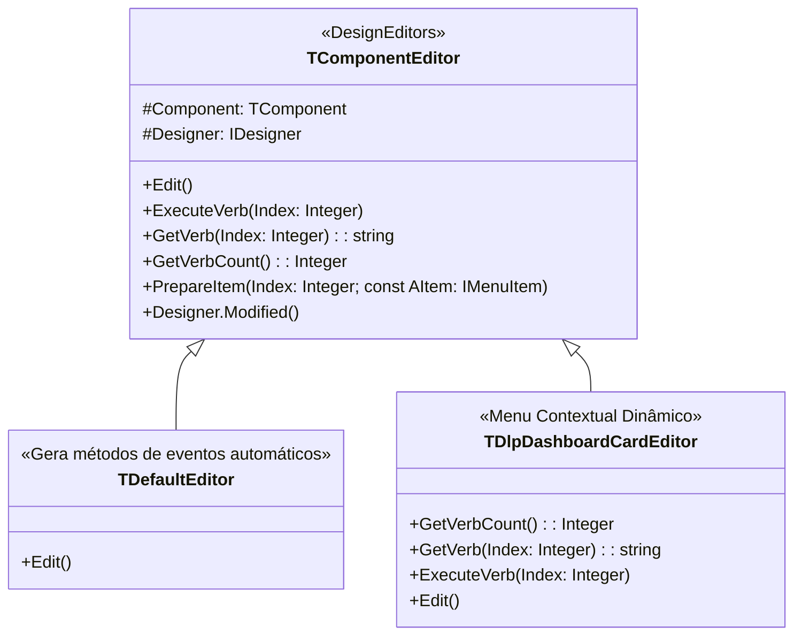

# MÓDULO 07: Component Editors e Ações de Design-Time (Verbos)

Enquanto o *Object Inspector* lida com a configuração de propriedades pontuais, o **Form Designer** do Delphi é o coração da experiência visual RAD. Quando o desenvolvedor clica com o botão direito em um componente colocado na tela ou executa um duplo-clique sobre ele, a IDE precisa saber como reagir.

A classe **`TComponentEditor`** (declarada em `DesignEditors`) é o instrumento oficial da Open Tools API do **Delphi 12 Athens+** para transformar controles passivos em instrumentos interativos de produtividade.

Neste módulo, aprenderemos como injetar verbos customizados no menu de contexto do formulário, controlar a ação padrão de duplo-clique através do método `Edit`, garantir a persistência de modificações com `Designer.Modified` e registrar editores na arquitetura de design-time do Delphi.

---

## 1. Arquitetura de Component Editors no Delphi 12

Toda a interação com componentes no Form Designer do Delphi passa pela interface `TComponentEditor`:



### 1.1 Ciclo de Vida do Editor de Componente
Diferente do componente em si (que vive enquanto o formulário estiver aberto no designer), o `TComponentEditor` é um objeto transitório e efêmero:
1. Quando o usuário clica com o botão direito no controle ou clica duas vezes com o mouse, a IDE consulta a tabela interna de editores registrados.
2. A IDE instancia o `TComponentEditor` correspondente e injeta a referência `Component` e o serviço `Designer`.
3. A IDE consulta `GetVerbCount` e `GetVerb` para montar o menu suspenso ou executa `Edit`.
4. Assim que a ação é concluída ou o menu é fechado, a instância do editor é destruída.

---

## 2. A Trinca de Métodos de Verbos

Para injetar ações no menu de contexto, sobrescrevemos:

### 2.1 `GetVerbCount: Integer; override;`
Retorna o número total de comandos do menu:
```pascal
function TDlpDashboardCardEditor.GetVerbCount: Integer;
begin
  Result := 5;
end;
```

### 2.2 `GetVerb(Index: Integer): string; override;`
Retorna o rótulo textual de cada item. Retornar `'-'` instrui a IDE a renderizar um separador gráfico:
```pascal
function TDlpDashboardCardEditor.GetVerb(Index: Integer): string;
begin
  case Index of
    0: Result := 'Alternar Tendência (Up / Down / Neutral)';
    1: Result := 'Inverter Tema (Dark / Light)';
    2: Result := 'Carregar Dados de Exemplo';
    3: Result := '-';
    4: Result := 'Sobre o TDlpDashboardCard...';
  else
    Result := '';
  end;
end;
```

### 2.3 `ExecuteVerb(Index: Integer); override;`
Executa o comando e notifica a IDE que o componente foi modificado:
```pascal
procedure TDlpDashboardCardEditor.ExecuteVerb(Index: Integer);
var
  Card: TDlpDashboardCard;
begin
  Card := TDlpDashboardCard(Component);
  case Index of
    0:
      begin
        Card.CycleTrend;
        Designer.Modified; // Notifica a IDE para persistir no .dfm
      end;
    // ...
  end;
end;
```

---

## 3. O Duplo-Clique: Sobrescrita do Método `Edit`

Por padrão, a classe `TDefaultEditor` procura o primeiro evento da seção `published` e gera um esqueleto de método no código Pascal. 

Quando herdamos de `TComponentEditor`, podemos redirecionar o duplo-clique para executar diretamente uma ação de produtividade:

```pascal
procedure TDlpDashboardCardEditor.Edit;
begin
  ExecuteVerb(0); // Alterna imediatamente a tendência do cartão no Form Designer
end;
```

---

## 4. O Registro com `RegisterComponentEditor`

Para associar o editor à classe do componente dentro do pacote de design-time:

```pascal
procedure Register;
begin
  RegisterComponentEditor(TDlpDashboardCard, TDlpDashboardCardEditor);
end;
```

---

## 5. Implementação Prática: Componente e Editor Completos

As duas unidades correspondentes foram estruturadas em:
- **`code/units/DlpDashboardCard.pas`:** Controle visual de cartão de KPI corporativo com desenho vetorial de badges de tendência (`tdUp`, `tdDown`, `tdNeutral`), suporte a Double Buffering e temas escuro/claro.
- **`code/units/DlpDashboardCardEditor.pas`:** Editor de componente especializado com 5 verbos de menu de contexto, alternância dinâmica de métricas e notificação de formulário modificado (`Designer.Modified`).

---

## 6. Checklist de Engenharia do Módulo 07

- [x] O `TComponentEditor` é instanciado sob demanda pela IDE e desalocado logo após a execução da ação.
- [x] Utilize `'-'` em `GetVerb` para organizar grupos conceituais de comandos no menu de contexto.
- [x] Sobrescreva `Edit` para substituir a geração automática de eventos por ações especializadas de design-time.
- [x] Nunca esqueça de chamar `Designer.Modified` após manipular o componente em tempo de design.
- [x] Registre o editor com `RegisterComponentEditor` exclusivamente no pacote de design-time (`DlpComponents_DT.dpk`).
