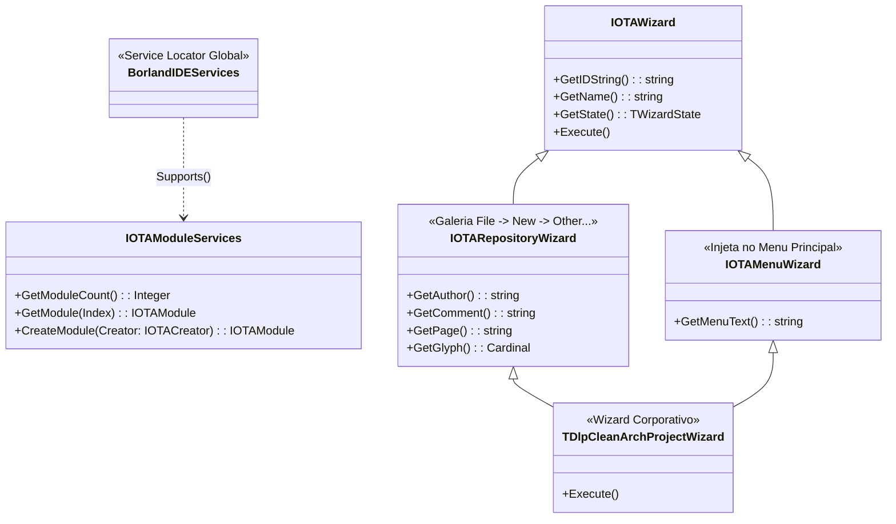

# MÓDULO 08: Assistentes de Projeto e Extensão da IDE (ToolsAPI Profunda)

No **Delphi 12 Athens+**, a **Open Tools API (OTA)** é o ápice da engenharia de integração com o ambiente de desenvolvimento. Através de um conjunto de interfaces COM puras (`ToolsAPI.pas`), a Embarcadero permite que arquitetos de software modifiquem radicalmente o comportamento do Delphi, adicionem novos itens à galeria de projetos, manipulem buffers de código em memória e automatizem a injeção de padrões de projeto complexos.

Em organizações que adotam práticas modernas como **Domain-Driven Design (DDD)** ou **Clean Architecture**, a ToolsAPI é a ferramenta que transforma diretrizes abstratas em automação concreta.

Neste módulo, aprenderemos a arquitetura interna da ToolsAPI, implementaremos o assistente corporativo `TDlpCleanArchProjectWizard` e dominaremos a geração de módulos e manipulação de código-fonte em tempo de design.

---

## 1. A Arquitetura da Open Tools API (OTA)

A ToolsAPI é fundamentada no padrão *Service Locator* através da variável global **`BorlandIDEServices`**. Toda comunicação com a IDE ocorre via consulta de interfaces (`QueryInterface` / `Supports`).



### 1.1 As Quatro Interfaces de um Wizard Completo
1. **`IOTAWizard`:** Interface atômica obrigatória. Define a identidade (`GetIDString`), o nome exibido (`GetName`), o estado de ativação (`GetState`) e a ação executada ao ser clicado (`Execute`).
2. **`IOTARepositoryWizard`:** Indica à IDE que o assistente deve aparecer na árvore de categorias da galeria de novos itens (`File -> New -> Other...`), organizando-se sob a aba retornada por `GetPage`.
3. **`IOTAMenuWizard`:** Injeta automaticamente um item executável no menu principal do Delphi sob o menu `Help` ou menu customizado.
4. **`IOTACreator` / `IOTAModuleCreator`:** O contrato responsável por sintetizar os arquivos em memória antes mesmo de serem salvos no disco.

---

## 2. A Síntese de Arquivos em Memória: `IOTAFile` e `IOTAModuleCreator`

Quando um assistente gera um novo arquivo, ele **não deve** salvá-lo no disco rígido usando `TFileStream`. Se o usuário decidir cancelar a operação ou fechar a aba sem salvar, o disco não deve conter lixo temporário.

A ToolsAPI fornece a interface de buffer virtual:

```pascal
type
  TDlpOTAFileBuffer = class(TInterfacedObject, IOTAFile)
  private
    FSourceCode: string;
  public
    constructor Create(const ASource: string);
    function GetSource: string;
    function GetAge: TDateTime;
  end;
```
Ao retornar `-1` em `GetAge`, sinalizamos ao Delphi que o arquivo é totalmente novo e ainda não existe no sistema de arquivos.

---

## 3. A Execução do Wizard: Injeção Via `IOTAModuleServices`

No método `Execute` da nossa classe:

```pascal
procedure TDlpCleanArchProjectWizard.Execute;
var
  ModServices: IOTAModuleServices;
begin
  if Supports(BorlandIDEServices, IOTAModuleServices, ModServices) then
  begin
    // Injeta a nova unit de Clean Architecture no editor de código ativo!
    ModServices.CreateModule(TDlpCleanModuleCreator.Create);
  end;
end;
```

A chamada `ModServices.CreateModule` cria uma nova aba no Code Editor do Delphi 12, contendo o esqueleto completo da camada de Domínio (`ICustomerRepository`) e da camada de Casos de Uso (`TCustomerService`), com suporte a syntax highlighting imediato.

---

## 4. O Registro com `RegisterPackageWizard`

Assistentes da ToolsAPI são registrados através da função global da unidade `ToolsAPI`:

```pascal
procedure Register;
begin
  RegisterPackageWizard(TDlpCleanArchProjectWizard.Create as IOTAWizard);
end;
```
Esse registro é realizado estritamente no pacote de design-time (`DlpComponents_DT.dpk`).

---

## 5. Implementação Prática: O Assistente Completo

A unidade completa está localizada em:
- **`code/units/DlpCleanArchProjectWizard.pas`:** Contém o buffer virtual `TDlpOTAFileBuffer`, o criador de módulos `TDlpCleanModuleCreator`, o wizard multiplataforma `TDlpCleanArchProjectWizard` e o registro oficial na ToolsAPI.

---

## 6. Checklist de Engenharia do Módulo 08

- [x] Utilize `BorlandIDEServices` e `Supports` para localizar serviços da ToolsAPI com segurança de tipo.
- [x] Nunca salve arquivos físicos diretamente no disco ao executar um wizard; utilize sempre implementações de `IOTAFile`.
- [x] Combine `IOTARepositoryWizard` e `IOTAMenuWizard` para máxima acessibilidade na interface da IDE.
- [x] Use `GetUnnamed = True` em criadores de módulo para que a IDE solicite o nome e diretório ao usuário no momento do salvamento (`Save / Save As`).
- [x] Registre wizards usando `RegisterPackageWizard` exclusivamente no pacote de design-time.
