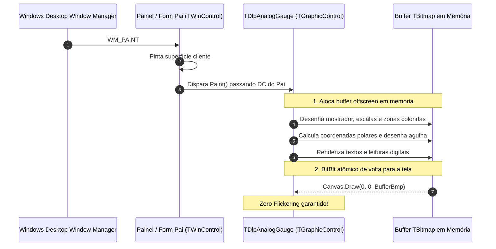

# MÓDULO 09: Controles Visuais Leves (TGraphicControl)

No ecossistema **Delphi 12 Athens+**, a **VCL** disponibiliza duas vias principais para criação de interfaces visuais: controles janelados pesados (`TWinControl`), que possuem um identificador nativo de janela (`HWND`), e controles gráficos leves (**`TGraphicControl`**), que operam sem handle (*windowless*).

Ao projetar dashboards industriais, cockpits de telemetria ou consoles de monitoramento com dezenas de mostradores gráficos e indicadores analógicos (VU Meters), instanciar múltiplos `TWinControl` impõe uma sobrecarga severa à tabela de handles da sessão do Windows (`USER32` / `GDI32`). 

A solução de alta performance é o uso de `TGraphicControl` combinado com **Double Buffering Manual**, cálculo trigonométrico preciso e renderização direta no `Canvas`.

Neste módulo, desvendaremos o pipeline gráfico de controles leves na VCL, implementaremos a matemática polar para instrumentos analógicos e construiremos o componente visual **`TDlpAnalogGauge`**.

---

## 1. O Funcionamento de `TGraphicControl` na VCL

Diferente de um `TPanel` ou `TEdit`, o `TGraphicControl` não consome recursos de janela do Windows:

> **IMPORTANTE: DOUBLEBUFFERED EM TGRAPHICCONTROL**
> A propriedade `DoubleBuffered` existe na classe `TWinControl`, mas **não** existe em `TGraphicControl`! Por isso, para controles gráficos leves não cintilarem durante atualizações intensivas de telemetria, o arquiteto de software deve implementar o padrão **Manual Offscreen Double Buffering** instanciando um `TBitmap` interno dentro do método virtual `Paint`.

---

## 2. A Matemática Polar dos Instrumentos Circulares

O mostrador do `TDlpAnalogGauge` opera sobre um arco de $270^\circ$, iniciando em $225^\circ$ (extremo inferior esquerdo) e terminando em $-45^\circ$ (extremo inferior direito).

### 2.1 Conversão de Escala Linear para Ângulo:
$$\text{Fração} = \frac{\text{Valor} - \text{MinValue}}{\text{MaxValue} - \text{MinValue}}$$
$$\text{Ângulo (graus)} = 225.0 - (\text{Fração} \times 270.0)$$

### 2.2 Transformação de Coordenadas Polares em Cartesianas:
Como a origem $(0, 0)$ do `TCanvas` localiza-se no canto superior esquerdo da tela e o eixo vertical cresce para baixo, invertemos o sinal do seno:
$$\theta = \text{DegToRad}(\text{Ângulo})$$
$$X = C_x + R \times \cos(\theta)$$
$$Y = C_y - R \times \sin(\theta)$$

---

## 3. Implementação Prática: O Componente `TDlpAnalogGauge`

O código-fonte integral está estruturado em:
- **`code/units/DlpAnalogGauge.pas`:** Mostrador analógico industrial com agulha animada, zonas de alerta diferenciadas (Normal em verde, Atenção em amarelo e Crítico em vermelho escuro), display digital inferior, graduações de escala (*ticks*) e disparo de evento reativo `OnThresholdCrossed`.

---

## 4. Checklist de Engenharia do Módulo 09

- [x] Herde de `TGraphicControl` para instrumentos cosméticos de alta densidade sem entrada de teclado.
- [x] Implemente Double Buffering manual via `TBitmap` em memória para eliminar 100% da cintilação de tela.
- [x] Utilize `EnsureRange` no método assessor `SetValue` para impedir extrapolações gráficas fora do arco do mostrador.
- [x] Aplique trigonometria polar com compensação de eixo $Y$ para desenho vetorial de escalas e agulhas.
- [x] Exponha eventos de transição de limite (`OnThresholdCrossed`) para integração reativa com regras de negócio ou alarmes do sistema.
