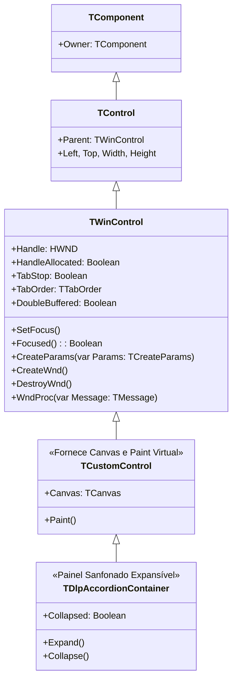

# MÓDULO 10: Controles Visuais Janelados (TWinControl)

No desenvolvimento avançado de aplicações corporativas no **Delphi 12 Athens+**, a espinha dorsal de qualquer layout de dados é formada por controles derivados de **`TWinControl`**.

Ao contrário dos controles leves windowless (`TGraphicControl`), um `TWinControl` é uma entidade do sistema operacional que encapsula diretamente um identificador de janela nativo (**`HWND`** no Windows). É essa integração com a API do Windows que confere ao controle:
1. **Identidade Física no SO:** Seu próprio loop de mensagens e capacidade de receber foco do usuário (`SetFocus`, `Focused`).
2. **Navegação por Teclado:** Participação no ciclo de tabulação (`TabStop`, `TabOrder`) e interceptação de teclas de comando (`OnKeyDown`, `OnKeyUp`).
3. **Contêiner de Filhos no Form Designer:** A faculdade de atuar como pai visual (`Parent`) de outros componentes e aceitar o drop de controles no designer através de **`csAcceptsControls`**.
4. **Double Buffering Nativo:** Suporte transparente à eliminação de cintilação via `DoubleBuffered := True`.

Neste módulo, dissecaremos a anatomia de `TWinControl` na VCL, contrastaremos sua mecânica com o `TStyledControl` do FireMonkey e implementaremos um contêiner sanfonado expansível completo (**`TDlpAccordionContainer`**) com animação a 60 FPS e acessibilidade por teclado.

---

## 1. A Anatomia do `TWinControl` na VCL

O pipeline de um controle janelado estende a hierarquia visual até o subsistema de janelas do Windows 11:



### 1.1 Contraste Arquitetural: VCL (`TWinControl`) vs. FireMonkey (`TStyledControl`)
- **Na VCL:** Cada `TWinControl` possui seu próprio `HWND`. O Windows é o responsável pelo recorte de tela (*clipping*), pelo roteamento de mensagens de mouse e pela hierarquia de profundidade Z-Order.
- **No FireMonkey (FMX):** Praticamente inexistem `HWNDs` para controles individuais. Toda a árvore de componentes deriva de `TFmxObject` $\to$ `TControl` $\to$ `TStyledControl`. A renderização é realizada inteiramente em uma única superfície acelerada por GPU (DirectX/Metal), onde a lógica de contêiner é puramente matemática e vetorial.

---

## 2. Hospedando Controles Filhos em Tempo de Design (`csAcceptsControls`)

Para construir um contêiner no Delphi (como o nosso `TDlpAccordionContainer` ou um card de formulário), devemos registrar no construtor:

```pascal
ControlStyle := ControlStyle + [csAcceptsControls, csCaptureMouse, csClickEvents, csDoubleClicks];
DoubleBuffered := True;
TabStop := True;
```

A flag `csAcceptsControls` instrui o Form Designer do Delphi a permitir que outros controles arrastados da Tool Palette (como edits, botões, grids) sejam soltos diretamente dentro da nossa área cliente, atribuindo automaticamente `ChildControl.Parent := Self`.

---

## 3. Animação de Expansão Fluida a 60 FPS

Ao alternar a propriedade `Collapsed`:
1. Em **Design-Time (`csDesigning in ComponentState`)**: Ajustamos a altura imediatamente para não interferir na produtividade do desenvolvedor.
2. Em **Run-Time**: Ativamos um `TTimer` de alta frequência (`Interval := 15` ms) que interpola a altura corrente até `FTargetHeight` com passos constantes, produzindo uma transição orgânica e fluida.

---

## 4. Implementação Prática: O Componente `TDlpAccordionContainer`

O código-fonte integral está estruturado em:
- **`code/units/DlpAccordionContainer.pas`:** Painel expansível construído sobre `TCustomControl`, suporte a `csAcceptsControls`, Double Buffering nativo, desenho de cabeçalho com chevron dinâmico (▼ / ►), navegação e disparo por teclado (`VK_SPACE` e `VK_RETURN`) e evento reativo `OnToggle`.

---

## 5. Checklist de Engenharia do Módulo 10

- [x] Herde de `TCustomControl` quando necessitar de um controle janelado com `HWND` e `Canvas` próprio.
- [x] Habilite `csAcceptsControls` no construtor para viabilizar a inserção de controles filhos em tempo de design.
- [x] Ative `DoubleBuffered := True` nativo em `TWinControl` para anular flickering sem esforço manual.
- [x] Processe `KeyDown` para garantir que o contêiner possa ser aberto ou fechado via teclado.
- [x] Desative animações automáticas quando o componente estiver sob a flag `csDesigning`.
