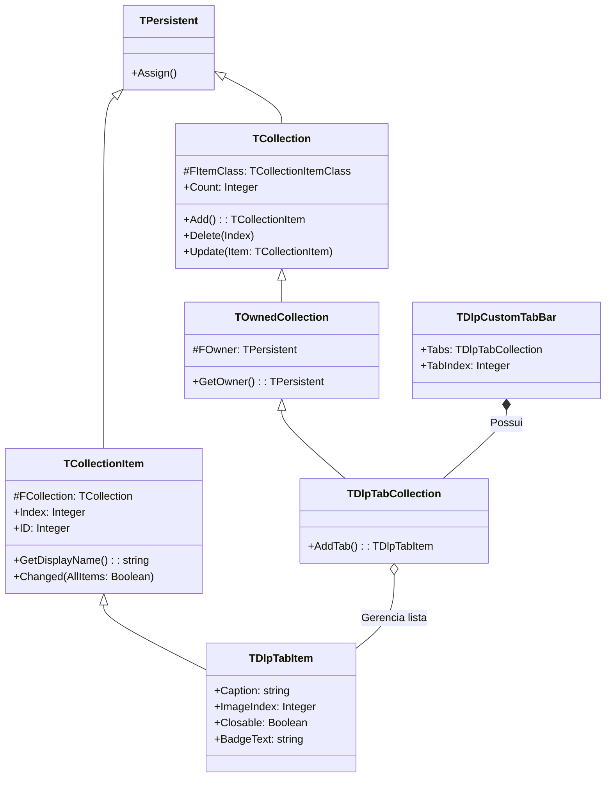

# MÓDULO 11: Coleções Tipadas e Sub-Propriedades Complexas

No desenvolvimento de controles visuais corporativos no **Delphi 12 Athens+**, o gerenciamento de sub-elementos estruturados (como abas de formulários, colunas de data grids, botões de toolbars ou itens de barras de status) exige uma arquitetura estritamente orientada a objetos que se integre de forma transparente tanto com o **Object Inspector** quanto com o motor de streaming **DFM**.

O padrão de arquitetura oficial da Embarcadero para este fim é a especialização de **`TOwnedCollection`** e **`TCollectionItem`**.

Neste módulo, dissecaremos o ciclo de vida e a serialização de coleções tipadas, aprenderemos como personalizar a exibição no **Collection Editor** da IDE através de `GetDisplayName`, como propagar notificações de repintura via `Update`, e implementaremos a barra de abas corporativa **`TDlpCustomTabBar`**.

---

## 1. A Hierarquia `TOwnedCollection` e `TCollectionItem`

A RTL do Delphi (`System.Classes`) fornece a fundação para listas polimórficas serializáveis:



### 1.1 O Papel Crítico de `TOwnedCollection`
Diferente da classe básica `TCollection`, a classe `TOwnedCollection` retém a referência do objeto proprietário (`AOwner: TPersistent`). Isso viabiliza:
1. **Identificação no DFM:** O leitor de formulário (`TReader`) sabe exatamente qual controle hospeda a coleção ao desserializar os itens do arquivo `.dfm`.
2. **Reatividade Imediata de Pintura:** Toda vez que um item da coleção é alterado, adicionado ou removido, o método `Update` da coleção é disparado automaticamente. Sobrescrevendo `Update`, podemos invalidar o controle pai sem necessidade de eventos manuais:
   ```pascal
   procedure TDlpTabCollection.Update(Item: TCollectionItem);
   begin
     inherited Update(Item);
     if GetOwner is TControl then
       TControl(GetOwner).Invalidate;
   end;
   ```

---

## 2. A Serialização Automática no Arquivo `.dfm`

Quando uma coleção é exposta na seção `published`:
```pascal
published
  property Tabs: TDlpTabCollection read FTabs write SetTabs;
```
O `TWriter` do Delphi serializa automaticamente os itens no `.dfm` sob a sintaxe de lista delimitada:

```text
object CustomTabBar: TDlpCustomTabBar
  Left = 16
  Top = 16
  Width = 500
  Height = 36
  TabIndex = 0
  Tabs = <
    item
      Caption = 'Geral'
      Closable = False
    end
    item
      Caption = 'Financeiro'
      BadgeText = 'NOVO'
      BadgeColor = clGreen
    end
    item
      Caption = 'Auditoria'
    end>
end
```

---

## 3. O Método `GetDisplayName` no Collection Editor do Delphi

Ao abrir o Collection Editor no Delphi 12, se não sobrescrevermos `GetDisplayName`, a lista exibirá:
- `0 - TDlpTabItem`
- `1 - TDlpTabItem`

Sobrescrevendo o método virtual:
```pascal
function TDlpTabItem.GetDisplayName: string;
begin
  if FCaption <> '' then
    Result := FCaption
  else
    Result := inherited GetDisplayName;
end;
```
A IDE passa a exibir instantaneamente:
- `0 - Geral`
- `1 - Financeiro`
- `2 - Auditoria`

---

## 4. Implementação Prática: O Componente `TDlpCustomTabBar`

O código-fonte integral está estruturado em:
- **`code/units/DlpCustomTabBar.pas`:** Controle visual de barra de abas moderna para Delphi 12, construído sobre `TCustomControl`, suporte a `TOwnedCollection`, itens dinâmicos com badges coloridos, botões de fechar `[×]` com efeito hover e evento reativo `OnTabClose(var CanClose: Boolean)`.

---

## 5. Checklist de Engenharia do Módulo 11

- [x] Utilize `TOwnedCollection` em vez de `TCollection` para manter a rastreabilidade do componente hospedeiro.
- [x] Sobrescreva `GetDisplayName` em subclasses de `TCollectionItem` para exibir rótulos informativos no Collection Editor.
- [x] Implemente `Assign` em `TCollectionItem` para garantir clonagem correta durante operações na IDE.
- [x] Propague repinturas automáticas sobrescrevendo `Update` na coleção.
- [x] Vincule e desvincule listas de imagens externas (`TCustomImageList`) usando o protocolo `FreeNotification`.
