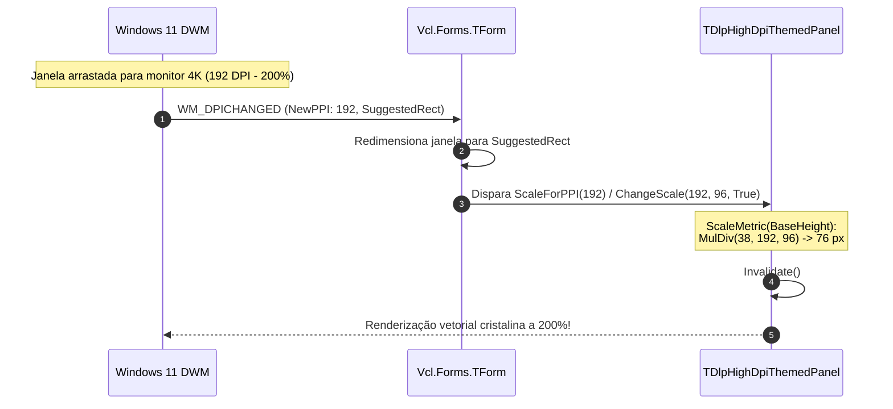

# MÓDULO 12: High-DPI, Escalonamento e Suporte a Temas Modernos

No ecossistema corporativo atual, aplicações desenvolvidas em **Delphi 12 Athens+** operam rotineiramente em configurações de múltiplos monitores heterogêneos: por exemplo, um notebook com tela de alta densidade (escala de 150% ou 144 DPI) conectado via Thunderbolt a um monitor de mesa 4K UHD (escala de 200% ou 192 DPI) e a um monitor secundário legado Full HD (escala de 100% ou 96 DPI).

Além disso, os usuários corporativos esperam que a aplicação responda dinamicamente às preferências de aparência do Windows 11, alternando suavemente entre **Dark Mode** e **Light Mode** sem necessidade de reiniciar o executável.

Neste módulo, dissecaremos a infraestrutura de **High-DPI Per-Monitor v2** da VCL, aprenderemos a implementar os métodos `ChangeScale` e `ScaleForPPI`, exploraremos a integração com o motor de estilos **VCL Styles (`TStyleManager`)** e construiremos o painel resiliente **`TDlpHighDpiThemedPanel`**.

---

## 1. A Evolução do Modelo High-DPI no Delphi

O Delphi percorreu três grandes eras no gerenciamento de DPI no Windows:

| Geração de DPI | Comportamento Operacional | Qualidade Visual |
| :--- | :--- | :--- |
| **DPI Unaware** | A aplicação informa ao SO que suporta apenas 96 DPI. O Windows estica o bitmap gerado. | Textos borrados e controles pixelados em monitores 4K. |
| **System DPI** | A aplicação consulta o DPI do monitor principal na inicialização e escala uma única vez. | Se movida para outro monitor com DPI diferente, fica borrada. |
| **Per-Monitor v2** (Moderno / Delphi 12) | O Windows envia `WM_DPICHANGED` em tempo real para a janela ao cruzar monitores. A VCL recalcula fontes, margens e bitmaps dinamicamente. | **Nitidez cristalina e perfeita em qualquer densidade (100% a 400%).** |



---

## 2. A Prevenção de Erros de Arredondamento Cumulativos

Um erro clássico cometido em componentes amadores é escalonar a própria variável de estado:
```pascal
// CÓDIGO INSEGURO / AMADOR
procedure TMeuControle.ChangeScale(M, D: Integer; isDpiChange: Boolean);
begin
  inherited ChangeScale(M, D, isDpiChange);
  FHeaderHeight := MulDiv(FHeaderHeight, M, D); // ERRO! Erro de arredondamento acumulativo!
end;
```
Se o usuário mover a janela várias vezes entre monitores de 125%, 150% e 100%, a divisão inteira perderá frações de pixel continuamente, fazendo com que a barra encolha ou cresça gradativamente.

### O Padrão Canônico: Base Metric vs. Scaled Metric
Sempre preserve o valor original em 96 DPI (`FBaseHeaderHeight := 38`) e recalcule a dimensão sob demanda usando a propriedade nativa `CurrentPPI`:

```pascal
function TDlpHighDpiThemedPanel.ScaleMetric(AValue: Integer): Integer;
begin
  Result := MulDiv(AValue, CurrentPPI, 96);
end;

procedure TDlpHighDpiThemedPanel.RecalculateScaledMetrics;
begin
  FScaledHeaderHeight := ScaleMetric(FBaseHeaderHeight);
  FScaledBorderRadius := ScaleMetric(FBaseBorderRadius);
  Invalidate;
end;
```

---

## 3. Integração com Temas do Windows 11 e VCL Styles

O Delphi 12 oferece suporte profundo a **VCL Styles** através de `Vcl.Themes.TStyleManager` e `StyleServices`.

Nosso componente avalia dinamicamente se o tema ativo é escuro ou claro, adaptando bordas, fundos e tipografia:

```pascal
if StyleServices.Enabled then
  IsDarkTheme := (ColorToRGB(StyleServices.GetSystemColor(clWindow)) < $00808080)
else
  IsDarkTheme := True;
```

---

## 4. Implementação Prática: O Componente `TDlpHighDpiThemedPanel`

O código-fonte integral está estruturado em:
- **`code/units/DlpHighDpiThemedPanel.pas`:** Painel com suporte a Per-Monitor v2, sobrescrita de `ChangeScale` e `ScaleForPPI`, cálculo dinâmico via `CurrentPPI`, integração com `StyleServices`, cantos arredondados escalonados e badge de diagnóstico de escala em tempo de execução.

---

## 5. Checklist de Engenharia do Módulo 12

- [x] Configure seu projeto Delphi com suporte a Per-Monitor v2 no Project Options (`Application -> Manifest -> DPI Awareness`).
- [x] Nunca recalcule métricas sobre valores já escalonados; mantenha constantes de design baseadas em 96 DPI.
- [x] Sobrescreva `ChangeScale` e `ScaleForPPI` em controles que armazenam medidas internas em pixels.
- [x] Utilize `CurrentPPI` para obter a densidade de pixels exata do monitor onde o controle reside.
- [x] Harmonize paletas de cores através de `StyleServices` para garantir aderência ao Dark Mode e Light Mode do Windows 11.
