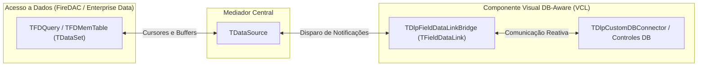
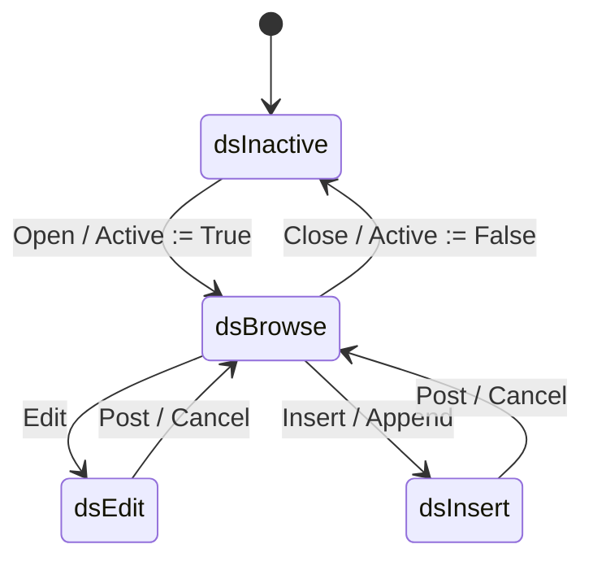

# MÓDULO 13: Arquitetura de Dados no Pascal e a Ponte TDataLink

No universo corporativo do **Delphi 12 Athens+**, o poder do desenvolvimento orientado a dados (**Data-Aware Architecture**) atinge seu nível máximo de sofisticação. Desde a comunicação de altíssima velocidade com bancos SQL corporativos através do **FireDAC** até a manipulação de estruturas em memória com `TFDMemTable`, a interface gráfica depende de um mecanismo robusto e reativo para sincronizar cursores de dados com a tela.

Tentar ler dados de campos diretamente em timers ou acoplar botões a referências diretas de `TFDQuery` viola o princípio de responsabilidade única e impede a criação de componentes reutilizáveis.

A solução canônica da Embarcadero baseia-se na **Ponte `TDataLink` / `TFieldDataLink`**, um mediador desacoplado que opera sob o padrão de projeto **Observer**.

Neste módulo, aprenderemos como funciona o fluxo interno entre `TDataSet`, `TDataSource` e a UI, a máquina de estados de edição e construiremos o componente framework base **`TDlpCustomDBConnector`**.

---

## 1. A Tríade Reativa no Delphi Moderno

O modelo de dados do Delphi estabelece um isolamento rigoroso entre a camada de persistência e a camada visual:

### 1.1 As Responsabilidades de Cada Ator:
- **`TDataSet` (ex: `TFDQuery`):** Mantém o cursor físico ou em memória, executa instruções SQL, gerencia transações e aloca buffers de registros.
- **`TDataSource`:** Atua como um *Hub/Mediator*. Centraliza eventos de navegação (`OnDataChange`, `OnUpdateData`) e permite que dezenas de controles na tela compartilhem o mesmo contexto sem se conhecerem mutuamente.
- **`TFieldDataLink`:** O motor interno do seu componente customizado. Ele se registra como um observador no `TDataSource` e traduz as mudanças de linha e de modo de edição em chamadas de métodos virtuais protegidos.

---

## 2. A Máquina de Estados e a Interceptação dos Cinco Métodos Sagrados

O ciclo de vida do `TDataSet` no Delphi transita entre estados bem definidos:

Ao herdar de `TFieldDataLink`, sobrescrevemos cinco métodos canônicos:

| Método Sobrescrito | Momento do Disparo | Ação no Componente Visual |
| :--- | :--- | :--- |
| **`ActiveChanged`** | Disparado ao abrir (`Open`) ou fechar (`Close`) a tabela. | Habilitar/desabilitar controles e atualizar status visual. |
| **`DataSetChanged`** | Disparado quando o cursor se move para outro registro ou ocorre `Refresh`. | Recarregar os dados na tela a partir do registro ativo. |
| **`EditingChanged`** | Disparado na transição de/para `dsEdit` ou `dsInsert`. | Habilitar foco de edição, mudar bordas ou acionar indicadores de status. |
| **`RecordChanged(Field)`** | Disparado quando o valor do campo vinculado é alterado na memória. | Atualizar o texto exibido sem necessariamente mover o cursor. |
| **`UpdateData`** | Disparado **imediatamente antes** do `TDataSet.Post`. | Despejar o texto modificado da interface de volta para o campo (`Field.AsString := Edit.Text`). |

---

## 3. Implementação Prática: O Framework `TDlpCustomDBConnector`

O código-fonte integral está estruturado em:
- **`code/units/DlpCustomDBConnector.pas`:** Unidade contendo o observador especializado `TDlpFieldDataLinkBridge` e a classe base `TDlpCustomDBConnector`, fornecendo os métodos `CanModify`, `Edit`, `Modified`, `Reset` e eventos fortemente tipados para estados de dados.

---

## 4. Checklist de Engenharia do Módulo 13

- [x] Nunca vincule controles visuais diretamente a instâncias de `TDataSet`; utilize sempre `TDataSource` como mediador.
- [x] Especialize `TFieldDataLink` para capturar as transições de cursor e estado do dataset.
- [x] No método `UpdateData`, sincronize o valor da tela de volta para o buffer do `TField` antes do `Post`.
- [x] Proteja ponteiros de `TDataSource` utilizando `FreeNotification` para evitar falhas de desalocação no Form Designer.
- [x] Utilize `DataLink.Edit` antes de aceitar digitação do usuário para garantir que o dataset entre legalmente em modo `dsEdit`.
