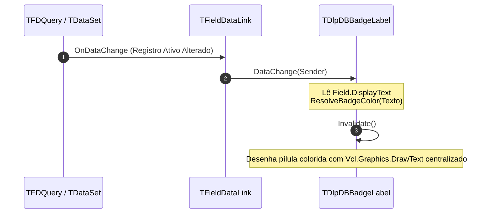

# MÓDULO 14: Controles DB-Aware Básicos de Exibição e Edição

A excelência de uma interface corporativa no **Delphi 12 Athens+** manifesta-se nos detalhes de usabilidade e na precisão com que os dados são apresentados e editados.

Em sistemas ERP, bancários e de gestão industrial, dois requisitos surgem constantemente:
1. **Pílulas Visuais de Status com Formatação Condicional (`TDlpDBBadgeLabel`):** Elementos gráficos windowless de alto rendimento que transformam códigos frios de banco (ex: `'A'`, `'P'`, `'C'`) em badges elegantes com cores intuitivas (Verde, Laranja, Cinza) e cantos arredondados.
2. **Caixas de Edição Monetária e Numérica (`TDlpDBNumberEdit`):** Controles com alinhamento à direita, máscara adaptativa ao foco, validação Unicode estrita via `CharInSet` e disparo automático da transição para `dsEdit` ao teclar.

Neste módulo, implementaremos esses dois componentes indispensáveis para a VCL.

---

## 1. O Controle `TDlpDBBadgeLabel`: Status Condicional Windowless

Construído sobre `TGraphicControl`, o `TDlpDBBadgeLabel` monitora o campo vinculado e repinta a si mesmo automaticamente:



---

## 2. O Controle `TDlpDBNumberEdit`: Entrada Monetária Fluida

O `TDlpDBNumberEdit` soluciona as três maiores frustrações de usuários corporativos:
- **Digitação Limpa:** Quando o usuário entra no campo (`DoEnter`), o símbolo de moeda é ocultado temporariamente, exibindo o número puro (`1450.75`).
- **Visualização Elegante:** Quando o usuário sai do campo (`DoExit`), o número é formatado no padrão contábil (`R$ 1.450,75`).
- **Edição Imediata:** Não requer cliques em botões de "Modificar". O primeiro caractere digitado dispara `DataLink.Edit` e `DataLink.Modified`.

### 2.1 Validação de Caracteres com `CharInSet`:
No Delphi Unicode, utilizamos a função otimizada `CharInSet`:
```pascal
procedure TDlpDBNumberEdit.KeyPress(var Key: Char);
begin
  if not CharInSet(Key, ['0'..'9', ',', '.', #8, #13, #27]) then
  begin
    Key := #0; // Bloqueia caracteres não numéricos
    Exit;
  end;

  if CharInSet(Key, ['0'..'9', ',', '.']) and not ReadOnly then
  begin
    if not FDataLink.Editing then
      FDataLink.Edit;

    FDataLink.Modified;
  end;

  inherited KeyPress(Key);
end;
```

---

## 3. Implementação Prática: Componentes Completos

A unidade completa está localizada em:
- **`code/units/DlpDBBasicControls.pas`:** Contém o `TDlpDBBadgeLabel` e o `TDlpDBNumberEdit`, ambos com suporte a `TFieldDataLink`, `FreeNotification` e registro oficial na categoria `'Engenharia Delphi 12'`.

---

## 4. Checklist de Engenharia do Módulo 14

- [x] Utilize `TGraphicControl` com `TFieldDataLink` para indicadores de status leves.
- [x] Configure `Alignment := taRightJustify` e `DoubleBuffered := True` em editores numéricos VCL.
- [x] Use `CharInSet` em vez de operadores `in` legados para compatibilidade e segurança Unicode no Delphi 12.
- [x] Chame `DataLink.Edit` no evento `KeyPress` antes de processar caracteres para colocar o dataset no modo `dsEdit`.
- [x] Envolva chamadas a `DataLink.UpdateRecord` em blocos `try..except SetFocus; raise; end` para reter o foco em caso de erro de validação.
