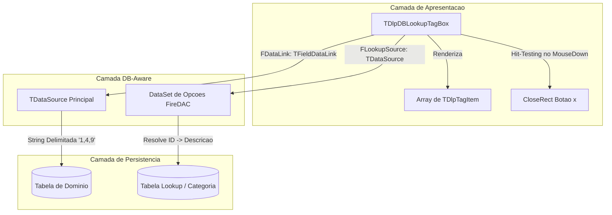

# MÓDULO 15: Controles DB-Aware Avançados e Seletores (TDlpDBLookupTagBox)

No ecossistema corporativo do Delphi, o desenvolvimento de interfaces modernas para seleção de entidades relacionais ultrapassou o formato rígido das antigas caixas combinadas (`TDBLookupComboBox`). Aplicações com alta densidade de informação demandam controles no formato de **etiquetas dinâmicas (*chips* ou *tags*)**, capazes de representar associações multivaloradas (ex.: categorias de produtos, perfis de acesso, múltiplos e-mails ou centros de custo) diretamente acoplados à camada de dados.

Neste módulo, construímos do zero o componente **`TDlpDBLookupTagBox`**, integrando os mecanismos de `TFieldDataLink`, double-buffering da VCL e resolução de dados relacionais com FireDAC.

---

## 1. Arquitetura de Seleção Múltipla Relacional

O controle resolve o clássico dilema de mapeamento de relacionamentos N:M em interfaces RAD através de um desacoplamento em três camadas:



### 1.1 Dupla Conexão com Dados:
1. **Conexão de Armazenamento (`DataSource` / `DataField`):** Vincula-se ao registro que está sendo editado. O campo armazena a representação serializada das chaves selecionadas (ex.: `"10,25,32"`).
2. **Conexão de Resolução (`LookupSource`, `LookupKeyField`, `LookupListField`):** Aponta para o `TFDQuery` ou `TFDTable` que contém a tabela de domínio (ex: chave primária e nome fantasia), permitindo traduzir o ID `10` em `"Financeiro"`, `25` em `"Recursos Humanos"`, etc.

---

## 2. Geometria de Renderização e Hit-Testing

Diferente de controles baseados em múltiplos botões filhos embutidos, o `TDlpDBLookupTagBox` realiza a renderização direta no `Canvas` da VCL com **DoubleBuffering**, garantindo performance extrema sem consumo de handles adicionais do Windows (`HWND`):

```pascal
type
  TDlpTagItem = record
    Key: string;
    Caption: string;
    Rect: TRect;
    CloseRect: TRect;
  end;

  TDlpTagItemArray = TArray<TDlpTagItem>;
```

### 2.1 Cálculo Responsivo de Quebra de Linha
No método `RecalculateTagLayout`, o componente itera pelas tags registradas, calcula a extensão da fonte (`Canvas.TextWidth`) e distribui as caixas arredondadas, quebrando a linha sempre que a margem direita for atingida:

```pascal
procedure TDlpDBLookupTagBox.RecalculateTagLayout;
var
  i, CurrentX, CurrentY, TagH, TextW, TagW: Integer;
begin
  Canvas.Font.Assign(Self.Font);
  TagH := 24;
  CurrentX := 4;
  CurrentY := 4;

  for i := 0 to High(FTags) do
  begin
    TextW := Canvas.TextWidth(FTags[i].Caption);
    TagW := TextW + 28;

    if (CurrentX + TagW > Width - 8) and (CurrentX > 4) then
    begin
      CurrentX := 4;
      Inc(CurrentY, TagH + 4);
    end;

    FTags[i].Rect := Rect(CurrentX, CurrentY, CurrentX + TagW, CurrentY + TagH);
    FTags[i].CloseRect := Rect(CurrentX + TagW - 18, CurrentY + 3, CurrentX + TagW - 2, CurrentY + TagH - 3);

    Inc(CurrentX, TagW + 6);
  end;
end;
```

---

## 3. O Ciclo de Edição e Sincronização via `TFieldDataLink`

O componente nunca altera o dataset diretamente sem passar pelas validações do ciclo de vida:

1. **Leitura Reativa (`DataChange`):** Quando o usuário navega pelo dataset mestre (`Prior`, `Next`), o evento `DataChange` invoca `ParseFieldValue`, dividindo a string bruta via `TStringList.StrictDelimiter` e populando as tags em tela.
2. **Entrada em Edição Segura (`Edit`):** Ao clicar no botão de fechar (`x`) de uma tag ou teclar `Backspace`, o método verifica se o `DataLink` já está em edição. Se não estiver, invoca `FDataLink.Edit`, disparando o estado `dsEdit` no `TDataSet`.
3. **Persistência (`UpdateData`):** Quando o usuário confirma a operação (`Post`) ou o componente perde o foco (`DoExit`), `FDataLink.UpdateRecord` chama `UpdateData`, serializando os IDs no formato delimitado configurado (`DelimitedChar`).

---

## 4. Código-Fonte Integral do Componente

A unidade Pascal completa, incluindo suporte a atalhos de teclado, foco visual temático e registro na paleta **"Delphi Component Engineering"**, está localizada em:

👉 **Arquivo:** [`code/units/DlpDBLookupTagBox.pas`](file:///d:/Projetos%20AntiGravity/Livros%20componentes/Livro2_Delphi_VCL_FMX/code/units/DlpDBLookupTagBox.pas)
