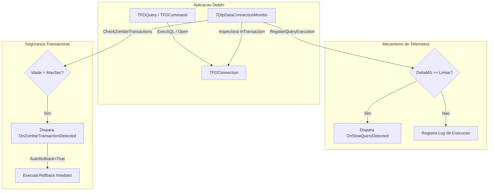

# MÓDULO 16: Monitoramento e Gerenciador de Transações de Dados (TDlpDataConnectionMonitor)

No desenvolvimento de sistemas corporativos de missão crítica em Delphi utilizando **FireDAC**, a governança das transações de banco de dados é um dos pilares mais vitais para a saúde da infraestrutura. O esquecimento de comandos `Commit` ou `Rollback` em blocos de exceção mal estruturados ou janelas modais deixadas abertas por operadores gera as chamadas **transações zumbis (ou transações órfãs)**. Essas transações mantêm bloqueios de leitura e escrita (*locks* de tabela e de registro), provocando enfileiramento de conexões, *deadlocks* e degradação severa dos servidores (Oracle, Microsoft SQL Server, PostgreSQL, Firebird).

Neste módulo, concebemos e construímos o componente não-visual **`TDlpDataConnectionMonitor`**, atuando como um cão de guarda (*watchdog*) e centralizador de telemetria para instâncias de `TFDConnection`.

---

## 1. Arquitetura de Auditoria de Conexões FireDAC

O `TDlpDataConnectionMonitor` atua desacoplado da lógica de negócio, auditando o estado interno da conexão através da API pública do FireDAC:



### 1.1 Ciclo de Monitoramento Transacional
O componente armazena o instante exato em que a transação foi deflagrada (`FTxStartTime`) e avalia dinamicamente se o tempo de vida extrapolou o limite aceitável (`MaxTransactionDurationSec`):

```pascal
function TDlpDataConnectionMonitor.GetTransactionAgeSeconds: Int64;
begin
  Result := 0;
  if IsTransactionActive and (FTxStartTime > 0) then
    Result := SecondsBetween(Now, FTxStartTime);
end;
```

---

## 2. Ação Automática sobre Transações Zumbis

O método `CheckZombieTransactions` pode ser acionado periodicamente (por exemplo, através de um `TTimer` de infraestrutura ou na rotina de fechamento de formulários). Caso detecte uma transação estagnada, ele notifica a aplicação via evento e, se a flag `AutoRollbackZombies` estiver ativa, força o `Rollback` para liberar os locks no banco:

```pascal
procedure TDlpDataConnectionMonitor.CheckZombieTransactions;
var
  AgeSec: Int64;
  ShouldRollback: Boolean;
begin
  if not FActive or not IsTransactionActive then
    Exit;

  AgeSec := GetTransactionAgeSeconds;
  if (AgeSec >= FMaxTransactionDurationSec) and (AgeSec > 0) then
  begin
    ShouldRollback := FAutoRollbackZombies;
    WriteLogEntry(Format('FIREDAC_ZOMBIE_TX_ALERT: Transação ativa por %d segundos.', [AgeSec]));

    if Assigned(FOnZombieTransactionDetected) then
      FOnZombieTransactionDetected(Self, FConnection, AgeSec, ShouldRollback);

    if ShouldRollback and FConnection.InTransaction then
    begin
      try
        FConnection.Rollback;
        FTxStartTime := 0;
        WriteLogEntry('FIREDAC_ZOMBIE_TX_ACTION: Rollback efetuado com sucesso.');
      except
        on E: Exception do
          WriteLogEntry('FIREDAC_ZOMBIE_TX_ERROR: Falha ao executar rollback: ' + E.Message);
      end;
    end;
  end;
end;
```

---

## 3. Telemetria de Consultas Lentas (Slow Queries)

Integrando a classe nativa de alta resolução `TStopwatch` (`System.Diagnostics`), a camada de repositório pode cronometrar as queries e encaminhar a métrica ao monitor:

```pascal
var
  Stopwatch: TStopwatch;
begin
  Stopwatch := TStopwatch.StartNew;
  try
    FDQuery.Open;
  finally
    Stopwatch.Stop;
    DlpDataConnectionMonitor1.RegisterQueryExecution(FDQuery.SQL.Text, Stopwatch.ElapsedMilliseconds);
  end;
end;
```

Se o tempo transcorrido for superior ao valor de `SlowQueryThresholdMS` (ex.: 1000 ms), o componente dispara o evento `OnSlowQueryDetected` e registra o incidente no arquivo de log com timestamp milissegundo.

---

## 4. Código-Fonte Integral do Componente

A unidade com a implementação completa, incluindo gerenciamento seguro de notificações de remoção (`FreeNotification`) e registro na paleta **"Delphi Component Engineering"**, está disponível em:

👉 **Arquivo:** [`code/units/DlpDataConnectionMonitor.pas`](file:///d:/Projetos%20AntiGravity/Livros%20componentes/Livro2_Delphi_VCL_FMX/code/units/DlpDataConnectionMonitor.pas)
