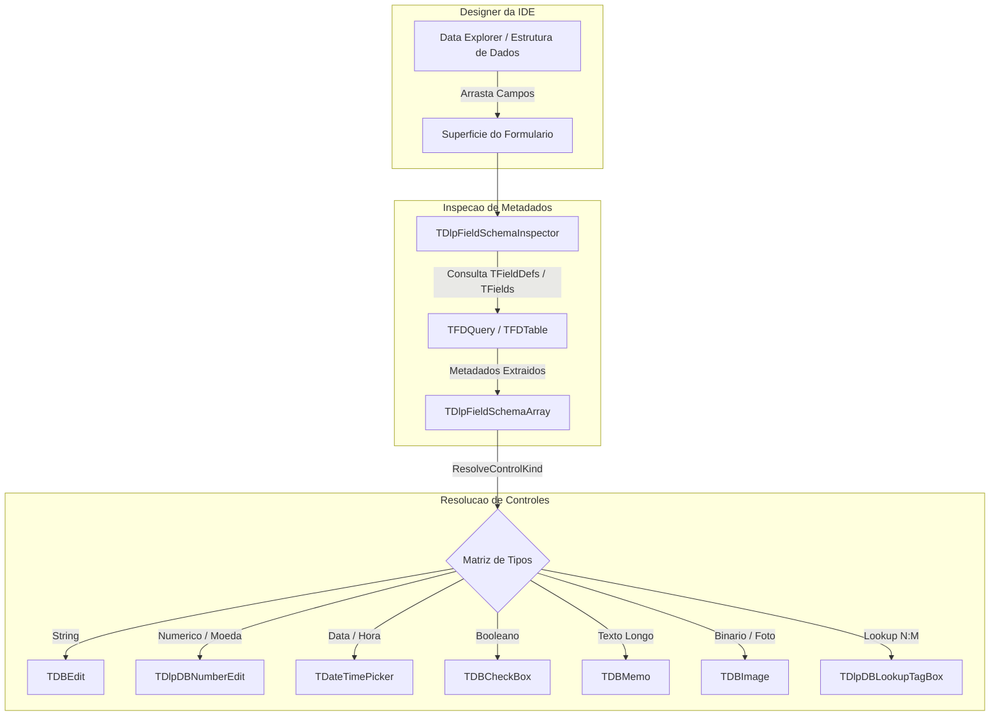

# MÓDULO 17: Engenharia de Arrastar e Soltar (Drag & Drop) no Designer

A filosofia RAD (*Rapid Application Development*) do Delphi sempre foi impulsionada pela interação visual intuitiva. O fluxo de arrastar conexões, tabelas e campos do **Data Explorer** diretamente para o designer de formulários e obter interfaces prontas em segundos é uma das marcas registradas da produtividade da ferramenta. No entanto, a criação manual de cada componente de tela (`TLabel`, `TDBEdit`, `TDBDateEdit`) em formulários extensos com dezenas de campos é repetitiva, propensa a erros de digitação e incompatível com os prazos de entregas corporativas modernas.

Neste módulo, detalhamos como a arquitetura de tempo de design da IDE interage com a introspecção de dados e implementamos o motor de metadados **`TDlpFieldSchemaInspector`**.

---

## 1. O Pipeline de Drag & Drop no Designer do Delphi

Quando o desenvolvedor arrasta uma tabela ou consulta FireDAC para a superfície do formulário, a IDE consulta a infraestrutura do designer (`IDesigner` / `IDesignerSelections`):



---

## 2. Introspecção Conectada vs. Desconectada

Um componente de automação de formulários deve ser capaz de operar mesmo quando a conexão com o banco não estiver ativa no computador do desenvolvedor em tempo de design. O método `InspectSchema` aborda essa necessidade com uma estratégia de contingência dupla:

1. **Modo Conectado (`FDataSet.Fields.Count > 0`):** Se os campos persistentes já foram criados pelo usuário ou se o dataset estiver aberto (`Active = True`), o motor extrai metadados refinados (`DisplayLabel`, `Required`, regras de validação).
2. **Modo Estrutural (`FDataSet.FieldDefs.Count > 0`):** Se o dataset estiver fechado, o motor dispara `FieldDefs.Update` para recuperar a definição das colunas diretamente do driver do FireDAC sem abrir os dados.

```pascal
if not FDataSet.Active and (FDataSet.FieldDefs.Count = 0) then
begin
  try
    FDataSet.FieldDefs.Update;
  except
    Exit;
  end;
end;
```

---

## 3. Matriz Declarativa de Mapeamento

A classe estática disponibiliza o método `ResolveControlKind`, convertendo cada constante `TFieldType` do Delphi na classificação de controle correspondente:

```pascal
class function TDlpFieldSchemaInspector.ResolveControlKind(
  AFieldType: TFieldType; ASize: Integer): TDlpControlKind;
begin
  case AFieldType of
    ftString, ftFixedChar, ftWideString, ftFixedWideChar:
    begin
      if ASize > 255 then
        Result := ckMemo
      else
        Result := ckTextEdit;
    end;

    ftSmallint, ftInteger, ftWord, ftFloat, ftCurrency, ftBCD, ftLargeint, ftFMTBcd:
      Result := ckNumberEdit;

    ftDate, ftTime, ftDateTime, ftTimeStamp:
      Result := ckDatePicker;

    ftBoolean:
      Result := ckCheckBox;

    ftBlob, ftGraphic, ftParadoxOle, ftDBaseOle:
      Result := ckImageBlob;

    ftMemo, ftWideMemo:
      Result := ckMemo;

    else
      Result := ckTextEdit;
  end;
end;
```

---

## 4. Código-Fonte Integral do Motor de Introspecção

A implementação integral do motor de análise de esquemas e mapeamento de tipos para o Delphi 12 Athens+ está disponível em:

👉 **Arquivo:** [`code/units/DlpFieldSchemaInspector.pas`](file:///d:/Projetos%20AntiGravity/Livros%20componentes/Livro2_Delphi_VCL_FMX/code/units/DlpFieldSchemaInspector.pas)
