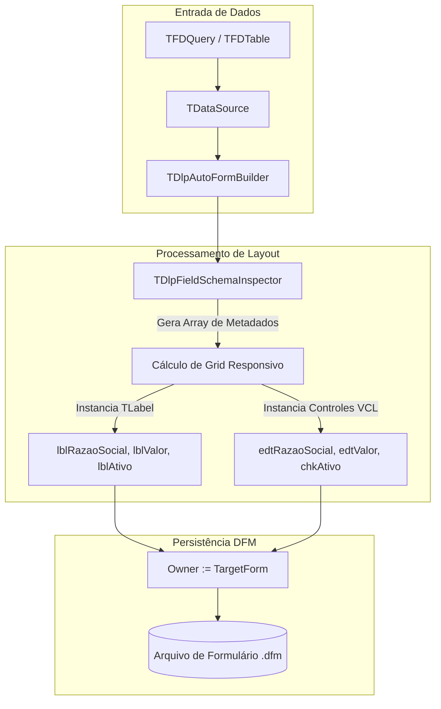

# MÓDULO 18: Construção do Componente Gerador de Cadastros (TDlpAutoFormBuilder)

Na construção de sistemas corporativos em Delphi, telas de cadastro de cadastros operacionais (CRUD) representam a maior parte do volume de código de interface de usuário. Configurar manualmente componentes visuais (`TLabel`, `TDBEdit`, `TDBMemo`), calcular coordenadas `Top` e `Left`, e vincular propriedades a datasets do FireDAC exige tempo excessivo e introduz inconsistências visuais em equipes com múltiplos desenvolvedores.

Neste módulo, concebemos e construímos o componente **`TDlpAutoFormBuilder`**, um contêiner automatizado para a **VCL (Delphi 12 Athens+)** que interpreta o esquema relacional em tempo de design ou execução, gera a interface em grid responsivo e injeta os componentes diretamente no arquivo `.dfm`.

---

## 1. Arquitetura do Componente e Herança de `TScrollBox`

O `TDlpAutoFormBuilder` herda de `TScrollBox`, garantindo suporte nativo a rolagem vertical para esquemas com dezenas de colunas:



---

## 2. Injeção de Componentes no Form e Persistência no DFM

Para que os componentes gerados dinamicamente se tornem membros legítimos da classe do formulário (permitindo ao desenvolvedor referenciá-los diretamente em código, como `edtNome.SetFocus`), o contêiner aplica uma regra estrita de posse (*Ownership*):

```pascal
TargetForm := GetOwnerForm;
if TargetForm <> nil then
  EffectiveOwner := TargetForm
else
  EffectiveOwner := Self;

// O Owner deve ser o Form para ser serializado no .dfm
NewEdit := TDBEdit.Create(EffectiveOwner);
NewEdit.Parent := Self;
NewEdit.Name := EffectiveOwner.FindUniqueName('edt' + SanitizedName);
```

---

## 3. Algoritmo de Posicionamento e Espaçamento

O controle distribui os elementos em colunas proporcionais (`ColumnsCount`), acomodando rótulo e caixa de entrada com cálculo dinâmico:

```pascal
UsableWidth := ClientWidth - (FHorizontalSpacing * (FColumnsCount + 1));
if UsableWidth < 200 then
  UsableWidth := 200;
ColWidth := UsableWidth div FColumnsCount;
```

A cada iteração:
1. Posiciona `TLabel` na coordenada `(CurLeft, RowTop)`.
2. Posiciona o controle na coordenada `(CurLeft, RowTop + LabelHeight + 2)`.
3. Incrementa o índice de coluna. Ao atingir o limite, pula para a linha seguinte somando a altura do controle ao espaçamento vertical (`VerticalSpacing`).

---

## 4. Código-Fonte Integral do Componente

A implementação completa do componente `TDlpAutoFormBuilder` está disponível em:

👉 **Arquivo:** [`code/units/DlpAutoFormBuilder.pas`](file:///d:/Projetos%20AntiGravity/Livros%20componentes/Livro2_Delphi_VCL_FMX/code/units/DlpAutoFormBuilder.pas)
