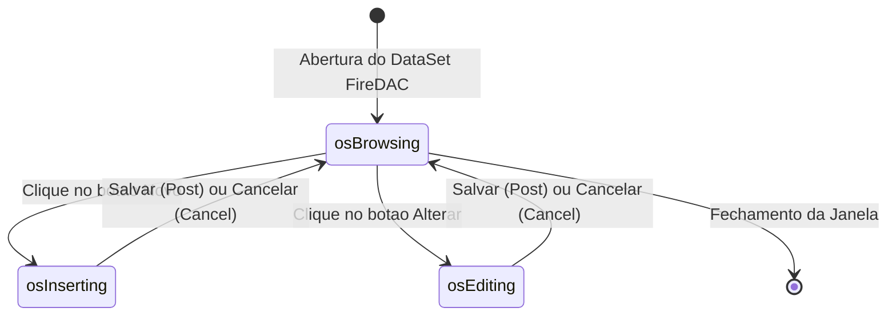

# MÓDULO 19: Caso de Estudo Real 1 — Gerador do Cadastro Completo de Clientes

A consolidação prática da arquitetura de componentes desenvolvida nos módulos anteriores se materializa de forma exemplar na construção do **Cadastro Corporativo de Clientes**. Neste estudo de caso, unificamos o contêiner gerador de telas `TDlpAutoFormBuilder`, a barra de controle transacional `TDlpCRUDOperationsBar` e o indicador visual de estado `TDlpDBBadgeLabel` em uma interface orientada a regras fiscais brasileiras.

---

## 1. Topologia da Interface de Usuário

O formulário de clientes é arquitetado em três camadas visuais coordenadas:

```
+---------------------------------------------------------------------------------+
| TDlpCRUDOperationsBar: [ Novo ] [ Alterar ] [ Salvar ] [ Cancelar ] [ Excluir ] |
+---------------------------------------------------------------------------------+
| Painel Superior: Status do Cliente -> TDlpDBBadgeLabel [ ATIVO / INATIVO ]      |
+---------------------------------------------------------------------------------+
| TDlpAutoFormBuilder:                                                            |
|  lblRazaoSocial           lblCNPJ                                               |
|  [ edtRazaoSocial       ] [ edtCNPJ                ]                            |
|  lblEmailFinanceiro       lblLimiteCredito                                      |
|  [ edtEmailFinanceiro   ] [ edtLimiteCredito       ]                            |
|  lblObservacoes                                                                 |
|  [ memObservacoes                                  ]                            |
+---------------------------------------------------------------------------------+
```

---

## 2. A Máquina de Estados Operacionais

A classe `TDlpCRUDOperationsBar` implementa a máquina de estados finitos que elimina inconsistências operacionais do usuário:



### 2.1 Validação de CPF e CNPJ por Módulo 11
Antes de persistir o registro no banco via `Post`, o evento `OnValidateRecord` intercepta a operação e submete o documento à validação matemática estática:

```pascal
procedure TFormClientes.CRUDBarValidateRecord(Sender: TObject; var CanSave: Boolean);
var
  Doc: string;
begin
  Doc := FDTableClientes.FieldByName('CPF_CNPJ').AsString;
  if Length(TDlpCRUDOperationsBar.OnlyDigits(Doc)) = 11 then
  begin
    if not TDlpCRUDOperationsBar.ValidateCPF(Doc) then
    begin
      ShowMessage('O CPF informado é inválido. Verifique os dígitos verificadores.');
      CanSave := False;
    end;
  end
  else if Length(TDlpCRUDOperationsBar.OnlyDigits(Doc)) = 14 then
  begin
    if not TDlpCRUDOperationsBar.ValidateCNPJ(Doc) then
    begin
      ShowMessage('O CNPJ informado é inválido. Verifique os dígitos verificadores.');
      CanSave := False;
    end;
  end
  else
  begin
    ShowMessage('Informe um CPF (11 dígitos) ou CNPJ (14 dígitos) válido.');
    CanSave := False;
  end;
end;
```

---

## 3. Código-Fonte Integral dos Componentes do Caso de Estudo

A implementação completa do componente `TDlpCRUDOperationsBar` com os algoritmos de validação de CPF e CNPJ está disponível em:

👉 **Arquivo:** [`code/units/DlpCRUDOperationsBar.pas`](file:///d:/Projetos%20AntiGravity/Livros%20componentes/Livro2_Delphi_VCL_FMX/code/units/DlpCRUDOperationsBar.pas)
