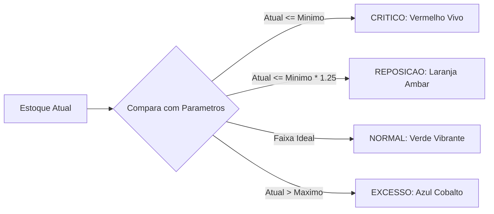

# MÓDULO 20: Caso de Estudo Real 2 — Gerador do Cadastro de Produtos e Itens

O catálogo de produtos constitui o núcleo transacional dos sistemas comerciais contemporâneos (ERP, PDV, Comércio Eletrônico). O desenvolvimento eficiente desse módulo requer mais do que meros campos cadastrais: impõe a integração de cálculos financeiros automatizados (margem de lucro comercial vs. índice de markup) e a visualização intuitiva da saúde do inventário de mercadorias.

Neste módulo, implementamos a arquitetura do **Cadastro de Produtos e Catálogo de Itens** combinando o gerador automatizado `TDlpAutoFormBuilder` e o componente de telemetria visual **`TDlpProductStockIndicator`**.

---

## 1. Topologia da Tela e Estrutura de Apresentação

A disposição visual reúne os componentes de persistência e os controles analíticos:

```
+---------------------------------------------------------------------------------+
| TDlpCRUDOperationsBar: [ Novo ] [ Alterar ] [ Salvar ] [ Cancelar ] [ Excluir ] |
+---------------------------------------------------------------------------------+
| TDlpAutoFormBuilder (Campos Principais do Produto):                             |
|  lblCodigoBarras            lblDescricao                                        |
|  [ edtCodigoBarras        ] [ edtDescricao                                    ] |
|  lblPrecoCusto              lblPrecoVenda                                       |
|  [ edtPrecoCusto          ] [ edtPrecoVenda                                   ] |
+---------------------------------------------------------------------------------+
| Painel de Inteligência de Negócio:                                              |
|  Margem de Lucro: [ 42.10% ]  |  Markup: [ 72.72% ]                             |
|  TDlpProductStockIndicator:                                                     |
|  Estoque: REPOSIÇÃO (18.0)                                                      |
|  [==========------------------------------------------------------------------] |
+---------------------------------------------------------------------------------+
```

---

## 2. Aritmética Comercial: Margem de Lucro vs. Markup

A distinção precisa entre margem de lucro e markup é crucial para a integridade de qualquer sistema de gestão:

- **Margem de Lucro:** Percentual de lucro obtido sobre o **preço de venda final**.
- **Markup:** Coeficiente multiplicador aplicado sobre o **preço de custo**.

$$
\text{Margem (\%)} = \frac{\text{Preço Venda} - \text{Preço Custo}}{\text{Preço Venda}} \times 100
$$

$$
\text{Markup (\%)} = \frac{\text{Preço Venda} - \text{Preço Custo}}{\text{Preço Custo}} \times 100
$$

O componente `TDlpProductStockIndicator` fornece essas rotinas nativas:

```pascal
class function TDlpProductStockIndicator.CalculateMargin(CostPrice, SellPrice: Double): Double;
begin
  if SellPrice <= 0 then
    Exit(0.0);
  Result := ((SellPrice - CostPrice) / SellPrice) * 100.0;
end;

class function TDlpProductStockIndicator.CalculateMarkup(CostPrice, SellPrice: Double): Double;
begin
  if CostPrice <= 0 then
    Exit(0.0);
  Result := ((SellPrice - CostPrice) / CostPrice) * 100.0;
end;
```

---

## 3. Monitoramento de Estoque com Indicadores Colorimétricos

O `TDlpProductStockIndicator` monitora dinamicamente a proporção entre `CurrentStockField`, `MinStockField` e `MaxStockField`, atualizando o gradiente e a legenda na barra de progresso:



---

## 4. Código-Fonte Integral do Componente

A implementação completa do medidor visual `TDlpProductStockIndicator` para o Delphi 12 Athens+ está disponível em:

👉 **Arquivo:** [`code/units/DlpProductStockIndicator.pas`](file:///d:/Projetos%20AntiGravity/Livros%20componentes/Livro2_Delphi_VCL_FMX/code/units/DlpProductStockIndicator.pas)
