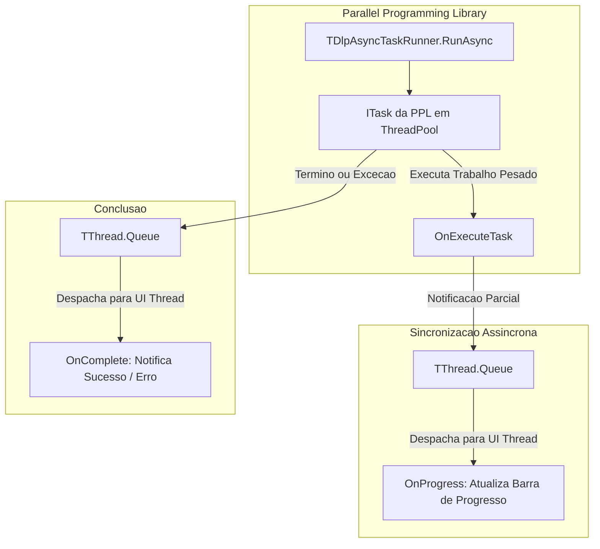

# MÓDULO 21: Componentes de Execução Assíncrona e Worker Threads (TDlpAsyncTaskRunner)

Manter a interface de usuário responsiva e fluida é um dos requisitos mais intransigentes de qualquer aplicação corporativa de alto padrão. Quando o software executa processamento massivo de registros, cálculos contábeis complexos ou requisições I/O sem transferir o trabalho para uma thread secundária, o sistema operacional Windows sinaliza a janela como *"Não Respondendo"*, resultando em frustração e desconfiança por parte do usuário.

Neste módulo, exploramos a concorrência moderna no **Delphi 12 Athens+** através da **PPL (Parallel Programming Library)** e construímos o componente não-visual **`TDlpAsyncTaskRunner`**.

---

## 1. Concorrência Segura no Delphi: A Afinidade da UI Thread

No ecossistema Delphi (tanto na VCL quanto no FireMonkey), todos os componentes visuais são projetados com afinidade unithread (*Main Thread Affinity*). Modificar propriedades de um controle visual diretamente a partir de um worker thread provoca violações de acesso imprevisíveis:



### 1.1 `TThread.Synchronize` vs. `TThread.Queue`
- **`Synchronize`:** Interrompe (*bloqueia*) a thread de trabalho até que a thread principal desenhe a interface. Isso cria gargalos severos e pode provocar *Deadlock* caso a tela esteja aguardando o término da thread via `TTask.Wait`.
- **`Queue`:** Enfileira o método anônimo no loop de mensagens do Windows de forma totalmente assíncrona. A thread de trabalho continua seu processamento em máxima velocidade sem qualquer bloqueio.

---

## 2. Cancelamento Cooperativo com `ITask`

A interrupção de tarefas concorrentes deve sempre respeitar o princípio do **Cancelamento Cooperativo**, no qual o código em execução consulta regularmente a variável booleana `Cancelled` para encerrar seus loops de maneira limpa:

```pascal
procedure TFormPrincipal.AsyncTaskRunnerExecuteTask(Sender: TObject; var Cancelled: Boolean);
var
  i: Integer;
begin
  for i := 1 to 500 do
  begin
    if Cancelled then
      Exit; // Interrupção segura sem vazamento de ponteiros

    ExecutarEtapaPesada(i);

    AsyncTaskRunner.NotifyProgress(i, 500, Format('Processando etapa %d de 500...', [i]));
  end;
end;
```

---

## 3. Código-Fonte Integral do Componente

A implementação completa do componente `TDlpAsyncTaskRunner`, compatível com VCL e FireMonkey no Delphi 12 Athens+, está disponível em:

👉 **Arquivo:** [`code/units/DlpAsyncTaskRunner.pas`](file:///d:/Projetos%20AntiGravity/Livros%20componentes/Livro2_Delphi_VCL_FMX/code/units/DlpAsyncTaskRunner.pas)
