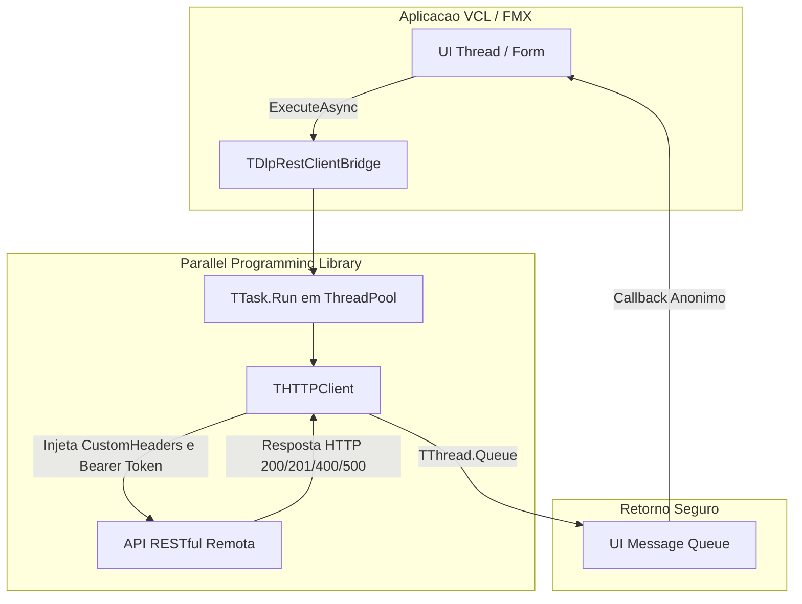

# MÓDULO 22: Componentes de Comunicação de Rede e Consumo de APIs (TDlpRestClientBridge)

A integração entre clientes de desktop corporativos e serviços em nuvem (APIs RESTful, microsserviços em Go/.NET/Node, gateways de autorização OAuth2/JWT e mensageria) é indispensável para sistemas modernos. Durante anos, desenvolvedores Delphi dependeram da suíte legada Indy (`TIdHTTP`), que sofria com complexidades de SSL/OpenSSL e exigia sincronização manual de threads.

Com a introdução do framework nativo **`System.Net.HttpClient`** aliada à **PPL (Parallel Programming Library)** no **Delphi 12 Athens+**, dispomos de uma arquitetura nativa com aceleração de hardware, validação de certificados via SO e suporte assíncrono de fábrica. Neste módulo, concebemos o componente **`TDlpRestClientBridge`**.

---

## 1. A Pilha Nativa de Rede: `System.Net.HttpClient`

Diferente de sockets legados em modo síncrono bloqueante, a biblioteca `System.Net.HttpClient` delega a comunicação para as APIs do sistema operacional (`WinHTTP` no Windows, `NSURLSession` no macOS/iOS e `HttpURLConnection` no Android):



---

## 2. Injeção de Segurança e Headers Customizados

A classe encapsula a configuração de cabeçalhos e controle de timeout milissegundo:

```pascal
function TDlpRestClientBridge.CreateConfiguredClient: THTTPClient;
var
  i: Integer;
begin
  Result := THTTPClient.Create;
  Result.ConnectionTimeout := FTimeoutSeconds * 1000;
  Result.ResponseTimeout := FTimeoutSeconds * 1000;
  Result.Accept := 'application/json';

  if FBearerToken <> '' then
    Result.CustomHeaders['Authorization'] := 'Bearer ' + FBearerToken;

  for i := 0 to FCustomHeaders.Count - 1 do
    Result.CustomHeaders[FCustomHeaders.Names[i]] := FCustomHeaders.ValueFromIndex[i];
end;
```

---

## 3. Despacho Assíncrono com Métodos Anônimos

O método `ExecuteAsync` dispara a requisição em um `TTask` isolado e retorna o resultado no contexto da thread de interface via `TThread.Queue`:

```pascal
procedure TFormPedidos.BtnSincronizarClick(Sender: TObject);
begin
  RestClient.ExecuteAsync('POST', '/api/v1/pedidos', JsonPayload,
    procedure(StatusCode: Integer; const ResponseBody, ErrorMsg: string)
    begin
      if StatusCode = 201 then
        ShowMessage('Pedido sincronizado com sucesso!')
      else
        ShowMessage(Format('Erro [%d]: %s', [StatusCode, ErrorMsg]));
    end);
end;
```

---

## 4. Código-Fonte Integral do Componente

A implementação completa do cliente RESTful `TDlpRestClientBridge` para Delphi 12 Athens+ está disponível em:

👉 **Arquivo:** [`code/units/DlpRestClientBridge.pas`](file:///d:/Projetos%20AntiGravity/Livros%20componentes/Livro2_Delphi_VCL_FMX/code/units/DlpRestClientBridge.pas)
