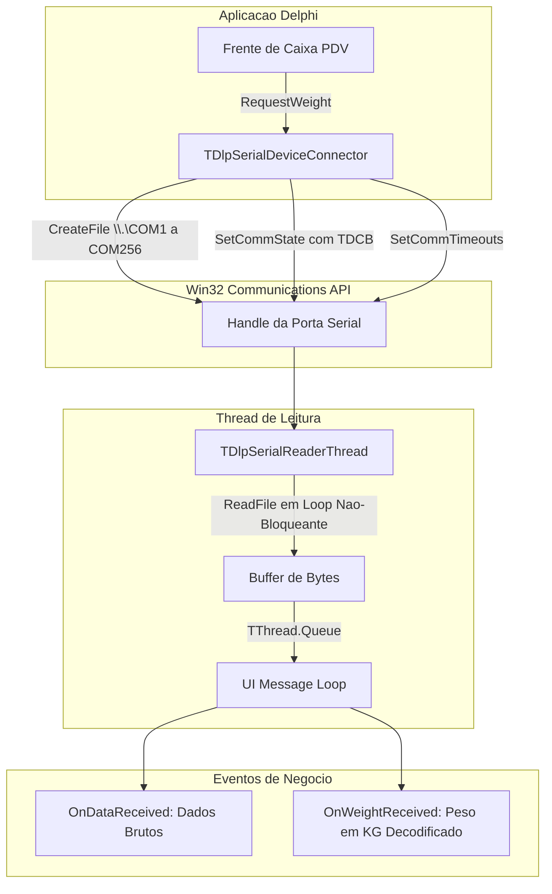

# MÓDULO 23: Componentes de Hardware, I/O e Comunicação Serial (TDlpSerialDeviceConnector)

No ecossistema de automação comercial e chão de fábrica (PDVs de supermercados, farmácias, balanças industriais, leitores de código de barras 2D/QRCode, impressoras térmicas ESC/POS e sensores industriais), a comunicação através de portas seriais físicas (RS-232, RS-485) e virtuais (USB CDC Serial Emulation) permanece como um dos pilares mais estáveis da tecnologia da informação.

Neste módulo, construímos o componente não-visual **`TDlpSerialDeviceConnector`**, implementado diretamente sobre a API nativa de comunicações do Windows (Win32 Communications API) no **Delphi 12 Athens+**, dotado de thread de leitura de baixa latência e decodificador integrado de protocolos de balanças de pesagem (Toledo, Filizola).

---

## 1. A API de Comunicações do Windows (Win32 Comm API)

O Windows trata portas de comunicação como arquivos orientados a fluxo de bytes, gerenciados por manipuladores de arquivo (`HANDLE`):



### 1.1 O Prefixo de Proteção de Portas no Windows
Ao abrir portas COM com índice igual ou maior que 10 (ex.: `COM11`, `COM18`), a chamada clássica `CreateFile('COM11', ...)` falha com erro de dispositivo não encontrado. É obrigatório estruturar a rota com a convenção de namespace do kernel:

```pascal
PortPath := '\\.\' + FPort; // Ex: '\\.\COM14'
FPortHandle := CreateFile(PChar(PortPath), GENERIC_READ or GENERIC_WRITE,
  0, nil, OPEN_EXISTING, FILE_ATTRIBUTE_NORMAL, 0);
```

---

## 2. Decodificação de Protocolos de Balanças de Checkout

As balanças de checkout mais consagradas no varejo nacional (Toledo Prix 3, Toledo 9094, Filizola Platina) seguem o protocolo padronizado de comando e resposta:

1. O sistema envia o caractere **`ENQ` (`#5`)** solicitando o peso estável.
2. A balança transmite uma mensagem contendo `STX` (`#2`), 5 caracteres ASCII numéricos representando o peso em gramas, e `ETX` (`#3`):

$$
\text{Quadro Retornado:} \quad [\text{STX}] \, \mathbf{0} \, \mathbf{3} \, \mathbf{5} \, \mathbf{0} \, \mathbf{0} \, [\text{ETX}] \implies 3.500 \text{ kg}
$$

A função estática `ParseToledoWeight` filtra os dígitos e converte o valor diretamente em ponto flutuante:

```pascal
class function TDlpSerialDeviceConnector.ParseToledoWeight(const ARaw: string): Double;
var
  CleanDigits: string;
  i, ValInt: Integer;
begin
  Result := 0.0;
  CleanDigits := '';
  for i := 1 to Length(ARaw) do
  begin
    if CharInSet(ARaw[i], ['0'..'9']) then
      CleanDigits := CleanDigits + ARaw[i];
  end;

  if Length(CleanDigits) >= 5 then
  begin
    CleanDigits := Copy(CleanDigits, Length(CleanDigits) - 4, 5);
    ValInt := StrToIntDef(CleanDigits, 0);
    Result := ValInt / 1000.0;
  end;
end;
```

---

## 3. Código-Fonte Integral do Componente

A implementação completa do conector de periféricos seriais `TDlpSerialDeviceConnector` está disponível em:

👉 **Arquivo:** [`code/units/DlpSerialDeviceConnector.pas`](file:///d:/Projetos%20AntiGravity/Livros%20componentes/Livro2_Delphi_VCL_FMX/code/units/DlpSerialDeviceConnector.pas)
