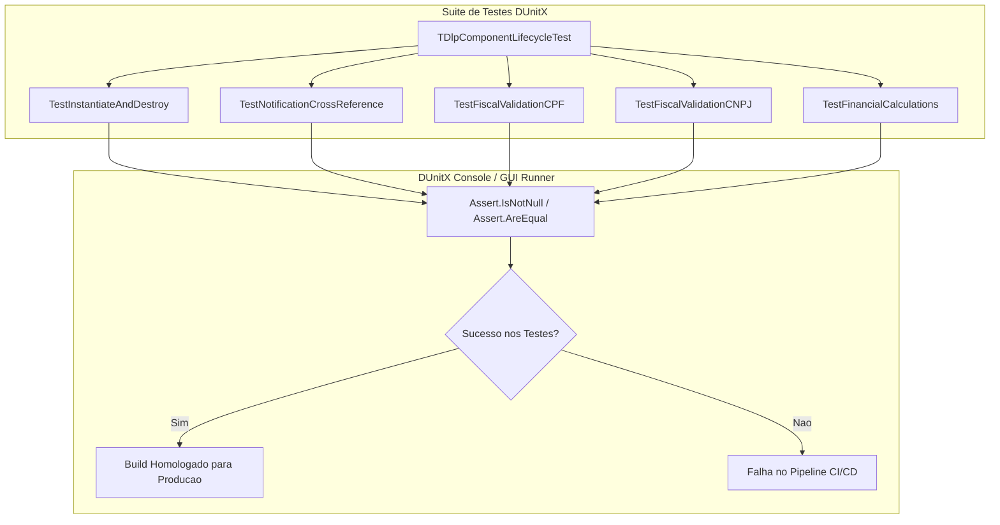

# MÓDULO 24: Testes Unitários de Componentes, Profiling e Prevenção de Leaks (DUnitX & FastMM5)

No desenvolvimento corporativo de componentes no Delphi, a robustez é medida pela capacidade da biblioteca de operar sob condições extremas sem provocar vazamentos de memória (*memory leaks*), degradações de desempenho por repinturas desnecessárias ou falhas de ponteiro órfão. A introdução de uma esteira automatizada de testes garante que cada alteração de código preserve a estabilidade de toda a suíte.

Neste módulo, implementamos uma bateria de testes unitários com o framework moderno **DUnitX** e estabelecemos as práticas de profiling de memória com **FastMM5** no **Delphi 12 Athens+**.

---

## 1. Automação de Testes com DUnitX

O DUnitX é o framework padrão de testes xUnit do Delphi moderno, baseado em atributos (`[TestFixture]`, `[Test]`):



### 1.1 Validando a Imunidade contra Ponteiros Órfãos
O teste unitário reproduz a destruição antecipada de um componente de formulário para certificar que o método `Notification` da classe host remove o ponteiro da lista interna:

```pascal
procedure TDlpComponentLifecycleTest.TestNotificationCrossReference;
var
  HostContainer: TDlpSafeLinkedContainer;
  TargetObj: TComponent;
begin
  HostContainer := TDlpSafeLinkedContainer.Create(nil);
  try
    TargetObj := TComponent.Create(nil);
    try
      HostContainer.LinkComponent(TargetObj);
      Assert.AreEqual(1, HostContainer.LinkedCount);
    finally
      TargetObj.Free; // Simula remoção no designer ou fechamento de tela
    end;

    // A contagem deve ter retornado a zero sem corrupção de memória
    Assert.AreEqual(0, HostContainer.LinkedCount);
  finally
    HostContainer.Free;
  end;
end;
```

---

## 2. Auditoria e Detecção de Vazamentos com FastMM5

O Delphi inclui de fábrica o FastMM integrado, permitindo ativar a detecção automática de leaks na inicialização do projeto de testes (`.dpr`):

```pascal
program DlpTestRunner;

uses
  FastMM5, // Deve ser a primeira unit do uses para interceptar todas as alocações
  DUnitX.AutoDetect.Console;

begin
  ReportMemoryLeaksOnShutdown := True;
  TDUnitX.CheckCommandLineAndRun;
end.
```

O FastMM5 provê proteção adicional contra *Buffer Overruns* e corrupção de tabelas de métodos virtuais (VMT), interceptando acessos a instâncias já liberadas (*Use-After-Free*).

---

## 3. Otimização de Repintura e o Padrão `WM_SETREDRAW`

Para controles janelados pesados (`TWinControl`), o uso de `LockWindowUpdate` pode congelar inadvertidamente outras janelas do sistema operacional. O padrão mais performático e elegante consiste em enviar a mensagem `WM_SETREDRAW`:

```pascal
procedure TDlpCustomTabBar.BeginUpdate;
begin
  if FUpdateCount = 0 then
    SendMessage(Handle, WM_SETREDRAW, 0, 0);
  Inc(FUpdateCount);
end;

procedure TDlpCustomTabBar.EndUpdate;
begin
  if FUpdateCount > 0 then
  begin
    Dec(FUpdateCount);
    if FUpdateCount = 0 then
    begin
      SendMessage(Handle, WM_SETREDRAW, 1, 0);
      RedrawWindow(Handle, nil, 0, RDW_INVALIDATE or RDW_ALLCHILDREN or RDW_UPDATENOW);
    end;
  end;
end;
```

---

## 4. Código-Fonte Integral da Suíte de Testes

A suíte completa de testes automatizados para Delphi 12 Athens+ está disponível em:

👉 **Arquivo:** [`code/units/DlpComponentTests.pas`](file:///d:/Projetos%20AntiGravity/Livros%20componentes/Livro2_Delphi_VCL_FMX/code/units/DlpComponentTests.pas)
