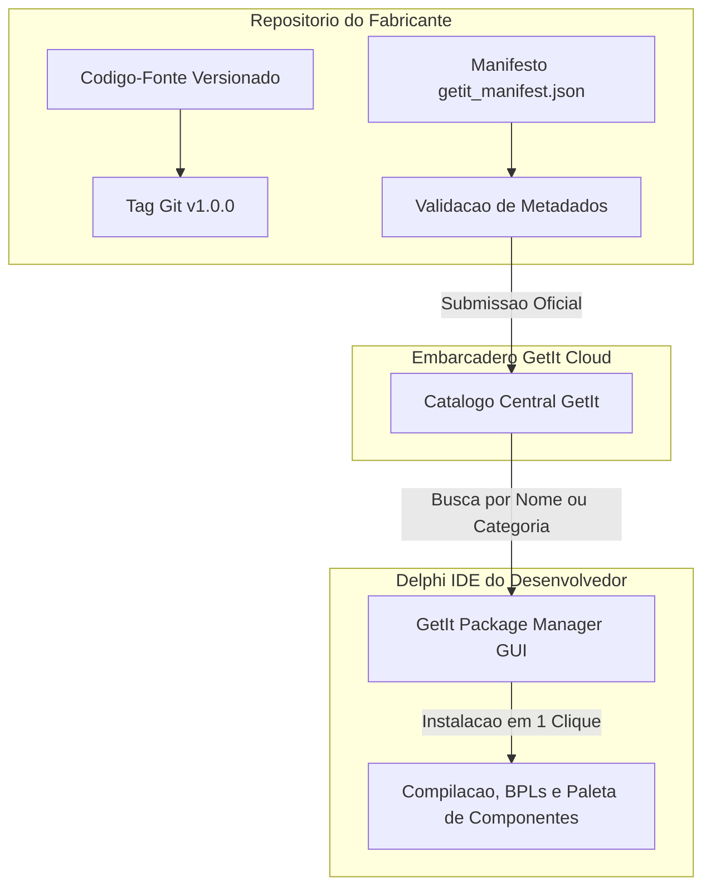

# MÓDULO 25: Publicação, Versionamento e Distribuição nos Ecossistemas Oficiais (GetIt & CI/CD com MSBuild)

A coroação da engenharia de componentes no Delphi é a sua distribuição para desenvolvedores e corporações ao redor do mundo. Um componente excepcional perde valor se sua instalação for manual, complexa ou dependente de passos obscuros de configuração de *Library Paths*. No Delphi moderno (**Delphi 12 Athens+**), o padrão ouro de distribuição é a inclusão no **GetIt Package Manager** e a validação contínua em esteiras de **CI/CD** utilizando o compilador de linha de comando acionado via **MSBuild**.

Neste módulo final, estabelecemos a estrutura profissional de distribuição, o manifesto oficial do GetIt e o pipeline automatizado de integração contínua.

---

## 1. Estrutura Corporativa de Repositório Delphi

Um repositório pronto para distribuição global e múltiplos targets de plataforma (Win32 e Win64) deve seguir a estrutura canônica:

```
repo-root/
├── .github/
│   └── workflows/
│       └── ci_msbuild.yml       # Pipeline automatizado de compilação e testes
├── docs/                        # Documentação técnica e guias de uso
├── src/                         # Fontes de execução das unidades (.pas)
├── design/                      # Editores de propriedades, verbos e wizards (.pas)
├── packages/
│   ├── DlpComponents_RT.dpk     # Pacote de Runtime (Win32 / Win64)
│   ├── DlpComponents_DT.dpk     # Pacote de Designtime (Win32 / IDE)
│   └── getit_manifest.json      # Manifesto de submissão ao GetIt
├── test/                        # Bateria de testes unitários com DUnitX
└── README.md                    # Apresentação e instruções de compilação
```

---

## 2. O Ecossistema GetIt Package Manager

O **GetIt** é o repositório central oficial mantido pela Embarcadero, acessível diretamente de dentro da IDE (*Tools -> GetIt Package Manager*):



### 2.1 Estrutura do Manifesto GetIt (`getit_manifest.json`)
O manifesto instrui o instalador do GetIt sobre quais projetos compilar e quais diretórios registrar no *Library Path*:

```json
{
  "id": "dlp.component.engineering",
  "name": "Delphi Component Engineering Suite",
  "version": "1.0.0",
  "compiler": "12.0",
  "product_name": "Delphi 12 Athens+",
  "platforms": [ "Win32", "Win64" ],
  "packages": [
    { "project": "DlpComponents_RT.dpk", "type": "Runtime", "platforms": [ "Win32", "Win64" ] },
    { "project": "DlpComponents_DT.dpk", "type": "Designtime", "platforms": [ "Win32" ] }
  ],
  "lib_paths": {
    "Win32": [ "lib\\Win32\\Release" ],
    "Win64": [ "lib\\Win64\\Release" ]
  }
}
```

---

## 3. Automação de CI/CD via MSBuild

O compilador do Delphi (`dcc32` e `dcc64`) integra-se nativamente ao motor de build padrão do Windows (`MSBuild`). Isso viabiliza compilar toda a suíte de pacotes em servidores headless (GitHub Actions ou GitLab Runners) sem necessidade de abrir a IDE:

```powershell
# Compilação do pacote de runtime para 32-bit e 64-bit
msbuild code/packages/DlpComponents_RT.dpk /p:Config=Release /p:Platform=Win32 /t:Build
msbuild code/packages/DlpComponents_RT.dpk /p:Config=Release /p:Platform=Win64 /t:Build

# Compilação do pacote de design-time (exclusivo 32-bit para a IDE)
msbuild code/packages/DlpComponents_DT.dpk /p:Config=Release /p:Platform=Win32 /t:Build
```

A esteira executa em seguida a suíte DUnitX, garantindo que nenhum merge seja concluído sem 100% de aprovação nos testes e zero vazamentos de memória.

---

## 4. Códigos e Arquivos de Infraestrutura

Os arquivos completos de manifesto e automação estão disponíveis em:

👉 **Manifesto GetIt:** [`code/packages/getit_manifest.json`](file:///d:/Projetos%20AntiGravity/Livros%20componentes/Livro2_Delphi_VCL_FMX/code/packages/getit_manifest.json)  
👉 **Pipeline GitHub Actions:** [`code/ci/github_actions_msbuild.yml`](file:///d:/Projetos%20AntiGravity/Livros%20componentes/Livro2_Delphi_VCL_FMX/code/ci/github_actions_msbuild.yml)
