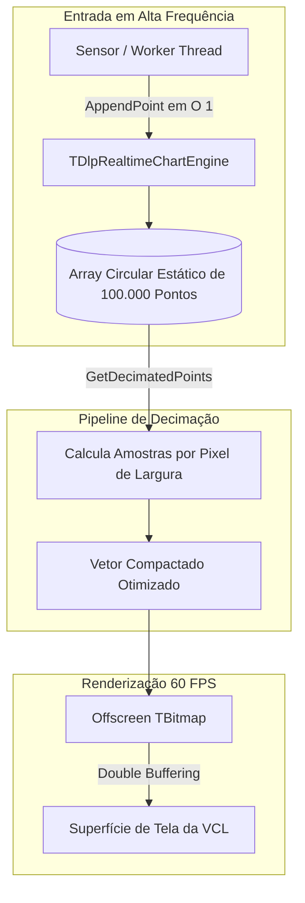

# MÓDULO 26: Gráficos de Alta Densidade em Tempo Real (TDlpRealtimeChartEngine)

O processamento e a renderização fluida de séries temporais de alta frequência representam um dos desafios gráficos mais exigentes no ecossistema Delphi. Em cenários com milhares de pontos por segundo (monitoramento de telemetria médica, osciloscópios digitais e dashboards industriais), bibliotecas tradicionais causam congelamentos na thread principal e perda inaceitável de quadros (*dropped frames*).

Neste módulo, implementamos o componente visual **`TDlpRealtimeChartEngine`**, explorando técnicas de alocação estática com **buffer circular para 100.000 pontos**, **decimação de alta performance** e desenho acelerado em memória com a **VCL (Delphi 12 Athens+)**.

---

## 1. Arquitetura do Motor de Telemetria

O componente desacopla o momento da amostragem (`AppendPoint`) da etapa de renderização gráfica (`Paint`):



---

## 2. Inserção sem Alocação Dinâmica (Zero Heap Allocations)

Para sustentar 100.000 registros sem acionar o gerenciador de memória repetidamente, o tamanho do array é fixado na inicialização:

```pascal
procedure TDlpRealtimeChartEngine.AppendPoint(const AValue: Double; const ATimestamp: TDateTime);
begin
  FBuffer[FHead].Value := AValue;
  FBuffer[FHead].Timestamp := ATimestamp;
  FHead := (FHead + 1) mod FCapacity;

  if FCount < FCapacity then
    Inc(FCount);

  if FAutoRange then
  begin
    if (FCount = 1) then
    begin
      FMinValue := AValue;
      FMaxValue := AValue;
    end
    else
    begin
      if AValue < FMinValue then FMinValue := AValue;
      if AValue > FMaxValue then FMaxValue := AValue;
    end;
  end;

  Invalidate;
end;
```

---

## 3. Decimação Dinâmica por Resolução de Tela

Quando o volume de amostras ultrapassa o limiar `DecimationThreshold`, o componente comprime os dados proporcionalmente ao número de pixels úteis da largura (`Width`), garantindo renderização instantânea a 60 FPS:

```pascal
if FCount > FDecimationThreshold then
  RenderPoints := GetDecimatedPoints(Width)
else
  RenderPoints := GetDecimatedPoints(FCount);
```

---

## 4. Código-Fonte Integral do Componente

A unidade completa do componente `TDlpRealtimeChartEngine` para Delphi 12 Athens+ está disponível em:

👉 **Arquivo:** [`code/units/DlpRealtimeChartEngine.pas`](file:///d:/Projetos%20AntiGravity/Livros%20componentes/Livro2_Delphi_VCL_FMX/code/units/DlpRealtimeChartEngine.pas)
