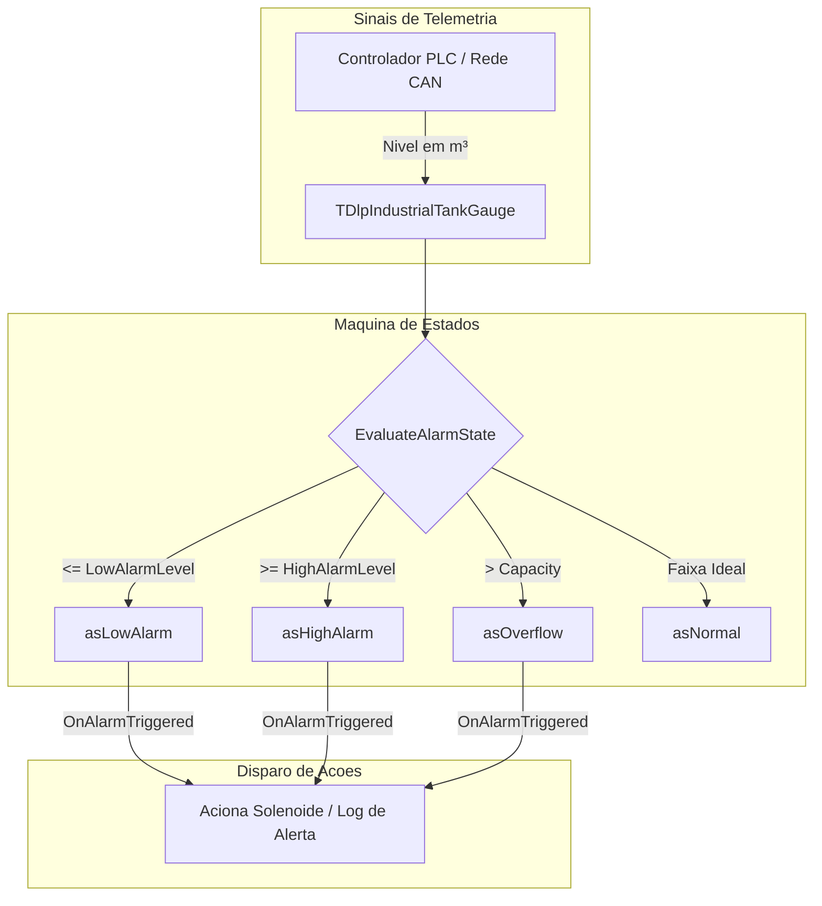

# MÓDULO 27: Medidores de Nível e Tanques Industriais (TDlpIndustrialTankGauge)

Em sistemas supervisórios SCADA e interfaces de controle de processos desenvolvidas em Delphi, a representação de silos e tanques de líquidos (combustíveis, grãos, produtos químicos) exige uma modelagem gráfica que vá além de simples barras de progresso retangulares. A equipe de engenharia necessita identificar visualmente o formato cilíndrico do recipiente, marcas de calibração numérica e a iminência de transbordo por meio de diferenciação de cores.

Neste módulo, construímos o componente vetorial **`TDlpIndustrialTankGauge`**, operando nativamente no Canvas da **VCL (Delphi 12 Athens+)** com baixo consumo de memória e notificações orientadas a eventos de segurança industrial.

---

## 1. Arquitetura Gráfica do Reservatório

O componente projeta um tanque industrial com proporções configuráveis e renderização antialias das bordas:



---

## 2. Renderização de Linhas de Calibração e Cúpula

O desenho utiliza funções vetoriais diretas do Canvas (`Rectangle`, `Arc`, `LineTo`), garantindo total nitidez em monitores com escalonamento High-DPI:

```pascal
// Paredes e domo do tanque
Canvas.MoveTo(TankLeft, TankTop + 10);
Canvas.LineTo(TankLeft, TankBottom);
Canvas.LineTo(TankRight, TankBottom);
Canvas.LineTo(TankRight, TankTop + 10);
Canvas.Arc(TankLeft, TankTop, TankRight, TankTop + 20,
           TankRight, TankTop + 10, TankLeft, TankTop + 10);
```

---

## 3. Código-Fonte Integral do Componente

A unidade com a implementação completa do medidor `TDlpIndustrialTankGauge` para Delphi 12 Athens+ está disponível em:

👉 **Arquivo:** [`code/units/DlpIndustrialTankGauge.pas`](file:///d:/Projetos%20AntiGravity/Livros%20componentes/Livro2_Delphi_VCL_FMX/code/units/DlpIndustrialTankGauge.pas)
