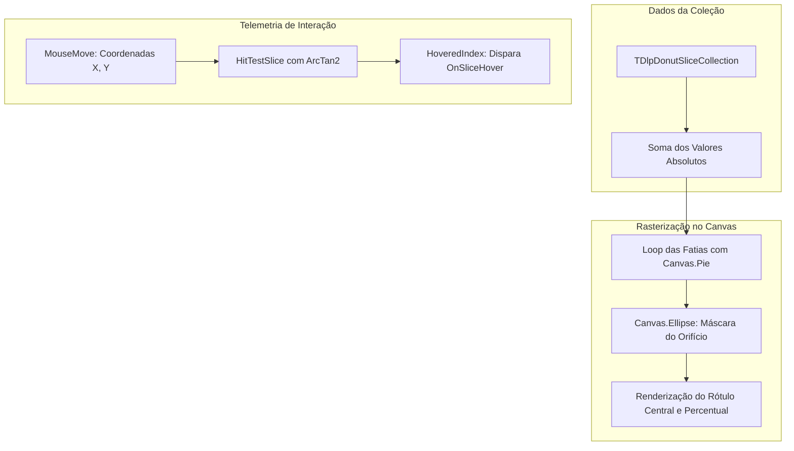

# MÓDULO 28: Gráficos de Radar e Donut Vetorial (TDlpVectorDonutChart)

Em aplicações executivas e suítes de BI construídas em Delphi, a clareza e a sobriedade na apresentação de dados categóricos determinam o sucesso da interface. Os gráficos tipo **Donut (Rosca)** constituem o padrão estético dos principais sistemas operacionais modernos, combinando simplicidade visual com alto aproveitamento do espaço de tela.

Neste módulo, concebemos o componente vetorial **`TDlpVectorDonutChart`**, operando nativamente sobre o `Canvas` da **VCL (Delphi 12 Athens+)**, provendo detecção de hover em tempo real via matemática polar e suporte completo a estilos visuais claros e escuros.

---

## 1. Arquitetura da Rosca e Projeção Trigonométrica

O controle decompõe o problema da geometria em setores circulares concêntricos:



---

## 2. Detecção Angular Polar sem Overhead de CPU

Para detectar qual fatia está sob o ponteiro do mouse sem sobrecarregar a thread de interface, o método `HitTestSlice` calcula a distância radial ao centro e o ângulo correspondente em graus:

```pascal
AngleRad := ArcTan2(Y - Cy, X - Cx);
AngleDeg := RadToDeg(AngleRad);
if AngleDeg < 0 then
  AngleDeg := AngleDeg + 360.0;
```

Se a distância estiver entre `InnerR` e `OuterR`, o componente itera pelas fatias acumulando `SweepAngle` até identificar o segmento exato, atualizando imediatamente o rótulo central com a porcentagem correspondente.

---

## 3. Código-Fonte Integral do Componente

A unidade com a implementação completa do componente `TDlpVectorDonutChart` para Delphi 12 Athens+ está disponível em:

👉 **Arquivo:** [`code/units/DlpVectorDonutChart.pas`](file:///d:/Projetos%20AntiGravity/Livros%20componentes/Livro2_Delphi_VCL_FMX/code/units/DlpVectorDonutChart.pas)
