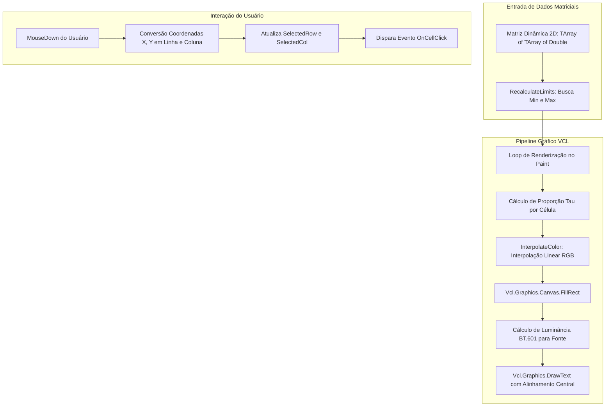

# MÓDULO 29: Visualizador de Mapas de Calor (TDlpMatrixHeatmap)

A visualização de densidade numérica em matrizes multidimensionais (*Heatmaps*) é um pilar da análise de inteligência de negócios (*BI*), bioinformática, matrizes de correlação em finanças quantitativas e monitoramento de servidores em escala. 

Neste módulo, construímos o **`TDlpMatrixHeatmap`**, projetado especificamente para Delphi 12 Athens+ VCL, utilizando a biblioteca gráfica nativa do Windows (GDI/Canvas com aceleração por double-buffering) e um algoritmo de interpolação termográfica em espaço vetorial RGB.

---

## 1. Arquitetura do Componente e Interpolação Cromática

O componente gerencia uma matriz bidimensional dinâmica fortemente tipada (`TArray<TArray<Double>>`). Os valores são mapeados continuamente entre as propriedades `MinColor` e `MaxColor`.



### Equação de Normalização e Interpolação Vetorial

Para cada elemento da matriz $M_{r, c}$, o percentual de transição cromática $\tau$ é calculado por:

$$
\tau = \text{Clamp}\left(\frac{M_{r, c} - V_{\min}}{V_{\max} - V_{\min}}, 0.0, 1.0\right)
$$

A cor resultante é expressa pela composição aditiva:

$$
C(\tau) = \text{RGB}\Big(R_1 + \tau(R_2 - R_1),\, G_1 + \tau(G_2 - G_1),\, B_1 + \tau(B_2 - B_1)\Big)
$$

---

## 2. Implementação e Seleção de Foco

O método `MouseDown` traduz a posição do ponteiro em índices matriciais imediatos sem iterações de laço desnecessárias:

```pascal
procedure TDlpMatrixHeatmap.MouseDown(Button: TMouseButton; Shift: TShiftState; X, Y: Integer);
var
  CellW, CellH: Single;
  R, C: Integer;
begin
  inherited MouseDown(Button, Shift, X, Y);
  if (Button = mbLeft) and (FRowCount > 0) and (FColCount > 0) then
  begin
    CellW := Width / FColCount;
    CellH := Height / FRowCount;
    C := Trunc(X / CellW);
    R := Trunc(Y / CellH);
    if (R >= 0) and (R < FRowCount) and (C >= 0) and (C < FColCount) then
    begin
      FSelectedRow := R;
      FSelectedCol := C;
      Invalidate;
      if Assigned(FOnCellClick) then
        FOnCellClick(Self, R, C, FData[R, C]);
    end;
  end;
end;
```

---

## 3. Código-Fonte e Registro na VCL

O código-fonte integral encontra-se em [`DlpMatrixHeatmap.pas`](file:///d:/Projetos%20AntiGravity/Livros%20componentes/Livro2_Delphi_VCL_FMX/code/units/DlpMatrixHeatmap.pas).

O componente é registrado na paleta `'Delphi Engenharia Avancada'` através de `RegisterComponents`, com suporte total ao Object Inspector do Delphi 12 Athens+.
