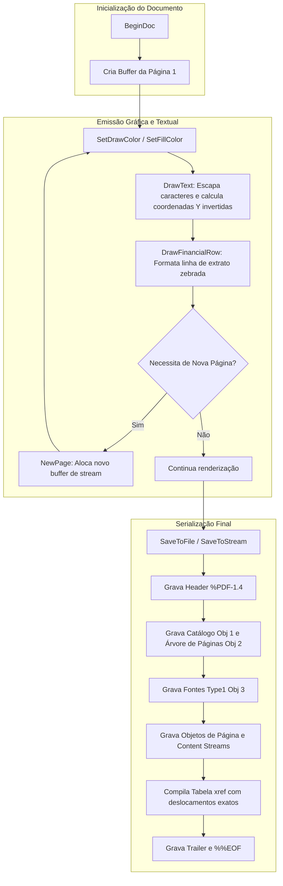

# MÓDULO 30: Motor Gerador de PDFs e Documentos Financeiros (TDlpFastPdfReportBuilder)

A geração de relatórios impressos e faturamento digital em formato PDF é indispensável em ecossistemas de software empresarial desenvolvidos em Delphi. A utilização de suítes de terceiros volumosas frequentemente acarreta overhead de memória, taxas de licenciamento elevadas ou dependências de arquivos de runtime adicionais.

Neste módulo, implementamos o **`TDlpFastPdfReportBuilder`** para Delphi 12 Athens+ (VCL e FMX), capaz de sintetizar binários PDF em conformidade com as normas Adobe PDF 1.4 de forma 100% nativa em Object Pascal.

---

## 1. Gramática do PDF e Diagrama de Fluxo

O gerador opera através de uma abordagem orientada a streaming: conforme os comandos de desenho (`DrawLine`, `DrawRect`, `DrawText`) são invocados pela aplicação consumidora, os operadores literais de baixo nível da especificação PostScript/PDF são gravados no buffer da página ativa.



---

## 2. Inversão do Plano Cartesiano e Escapamento Tipográfico

No Delphi moderno com suporte a strings Unicode (UTF-16), a serialização para o stream binário do PDF requer conversão precisa para ANSI/WinAnsiEncoding:

```pascal
function TDlpFastPdfReportBuilder.EscapePdfString(const S: string): string;
var
  i: Integer;
begin
  Result := '';
  for i := 1 to Length(S) do
  begin
    case S[i] of
      '(': Result := Result + '\(';
      ')': Result := Result + '\)';
      '\': Result := Result + '\\';
    else
      Result := Result + S[i];
    end;
  end;
end;
```

A escrita de streams numéricos de ponto flutuante adota obrigatoriamente `TFormatSettings.Invariant`, impedindo que vírgulas decimais da localidade brasileira (PT-BR) corrompam a sintaxe padrão do PDF:

```pascal
Cmd := Format('%.2f %.2f %.2f %.2f re %s'#10, [Px, Py, Pw, Ph, Op], TFormatSettings.Invariant);
GetCurrentPage.ContentStream.WriteString(Cmd);
```

---

## 3. Código-Fonte e Registro na Paleta

O código integral está disponível em [`DlpFastPdfReport.pas`](file:///d:/Projetos%20AntiGravity/Livros%20componentes/Livro2_Delphi_VCL_FMX/code/units/DlpFastPdfReport.pas).

O componente é registrado em `Delphi Engenharia Avancada` e pode ser utilizado tanto em aplicações cliente Desktop quanto em microserviços de backend (Console, Windows Services, Linux Daemons).
