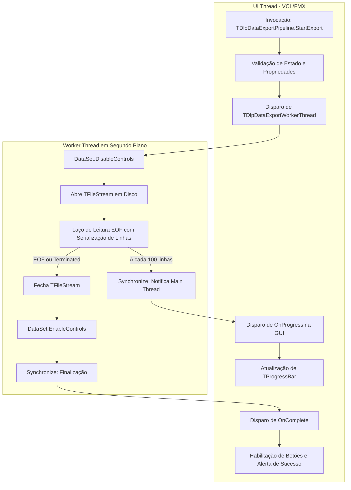

# MÓDULO 31: Pipeline de Exportação em Segundo Plano (TDlpDataExportPipeline)

Em aplicações corporativas construídas sobre a suíte FireDAC ou instâncias heterogêneas de `TDataSet` no Delphi 12 Athens+, a conversão e o despejo de grandes massas de dados para formatos interoperáveis (CSV, JSONL, planilhas) pode consumir dezenas de segundos ou minutos. A retenção da thread de interface durante esse processamento acarreta degradação severa da experiência do operador.

Neste módulo, implementamos o **`TDlpDataExportPipeline`**, projetado para desacoplar integralmente a exportação de dados através de `TThread` autônoma, garantindo segurança transacional, desativação de controles visuais com `DisableControls` e feedback de progresso sem concorrência.

---

## 1. Topologia de Concorrência e Tratamento Transacional



### Isolamento de Falhas e Cancelamento Graceful

A thread respeita a propriedade `Terminated` em cada iteração do laço. Se o usuário clicar no botão Cancelar, o pipeline interrompe imediatamente a gravação e limpa os recursos sem corromper o cursor do banco de dados:

```pascal
procedure TDlpDataExportPipeline.CancelExport;
begin
  if FIsBusy and Assigned(FWorkerThread) then
  begin
    FWorkerThread.Terminate;
    FWorkerThread.WaitFor;
    FreeAndNil(FWorkerThread);
    FIsBusy := False;
  end;
end;
```

---

## 2. Formatos Suportados: CSV, JSONL e Planilhas XML

1. **CSV (RFC 4180):** Separação por ponto-e-vírgula (`;`) ou vírgula, com sanitização de quebras de linha e escape de aspas duplas.
2. **JSONL (JSON Lines):** O padrão universal para pipelines de Machine Learning, pipelines de embeddings e exportações para Elasticsearch / MongoDB.
3. **XML Spreadsheet:** Documentos em conformidade com o esquema Microsoft Office 2003, permitindo abertura nativa no Excel com formatação sem necessitar de instalação de DLLs COM/ActiveX.

---

## 3. Código-Fonte e Registro na Paleta

O código integral encontra-se em [`DlpDataExportPipeline.pas`](file:///d:/Projetos%20AntiGravity/Livros%20componentes/Livro2_Delphi_VCL_FMX/code/units/DlpDataExportPipeline.pas).

O componente é registrado na paleta `'Delphi Engenharia Avancada'`, pronto para uso em projetos VCL e FireMonkey.
