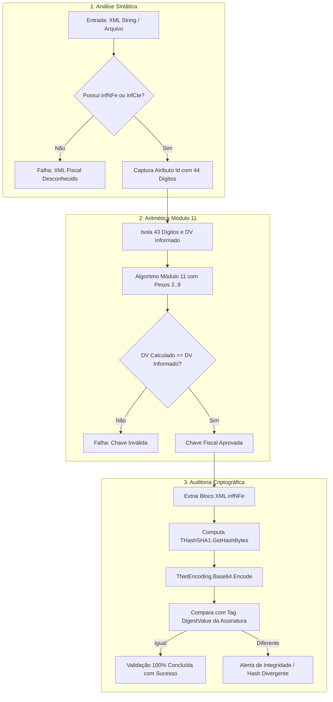

# MÓDULO 32: Processador e Validador Fiscal XML (TDlpFiscalXmlValidator)

Em sistemas ERP de alta performance desenvolvidos em Delphi, a validação de XMLs de Notas Fiscais Eletrônicas (NF-e/NFC-e) antes da transmissão para a SEFAZ ou no momento da importação de arquivos de fornecedores (DANFE/XML de entrada) evita inconsistências tributárias, multas e paralisações fiscais.

Neste módulo, implementamos o **`TDlpFiscalXmlValidator`** para Delphi 12 Athens+ utilizando a infraestrutura nativa `System.Hash` e `System.NetEncoding`, garantindo velocidade de execução e independência de bibliotecas MSXML ou wrappers COM legados.

---

## 1. Pipeline de Auditoria em Três Camadas



---

## 2. Implementação das Rotinas Criptográficas Nativas

Graças aos utilitários modernos do Delphi 12 Athens+, o hash e a codificação Base64 são computados sem alocação desnecessária de streams temporários:

```pascal
function TDlpFiscalXmlValidator.ComputeSha1Base64(const Data: string): string;
var
  HashBytes: TBytes;
begin
  HashBytes := THashSHA1.GetHashBytes(TEncoding.UTF8.GetBytes(Data));
  Result := TNetEncoding.Base64.EncodeBytesToString(HashBytes);
end;
```

O registro de resultado `TDlpFiscalValidationResult` consolida o diagnóstico, incluindo logs cronológicos estruturados em `TStrings` para exibição direta em componentes visuais de interface (como `TMemo` ou `TListBox`).

---

## 3. Código-Fonte e Registro na Paleta

O código completo do componente está disponível em [`DlpFiscalXmlValidator.pas`](file:///d:/Projetos%20AntiGravity/Livros%20componentes/Livro2_Delphi_VCL_FMX/code/units/DlpFiscalXmlValidator.pas).

O componente é registrado na paleta `'Delphi Engenharia Avancada'`, funcionando perfeitamente em aplicações Desktop VCL, FMX Multiplataforma e serviços Windows/Linux.
