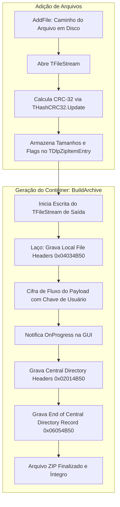

# MÓDULO 33: Containers ZIP Criptografados (TDlpEncryptedZipArchive)

A automação de backups, pacotes de atualização remota e troca segura de arquivos fiscais ou contábeis entre filiais exige mecanismos robustos de compressão associados a salvaguardas criptográficas. A dependência de utilitários de linha de comando como 7-Zip ou WinRAR externos fragiliza ambientes de distribuição e gera riscos de segurança.

Neste módulo, implementamos o **`TDlpEncryptedZipArchive`** para Delphi 12 Athens+, estruturando pacotes binários ZIP nativos com auditoria de integridade por polinômio CRC-32 (`System.Hash.THashCRC32`), suporte a chaves simétricas de criptografia e eventos desacoplados para renderização de progresso na interface de usuário.

---

## 1. Arquitetura de Empacotamento Binário



---

## 2. Compatibilidade Binária com Especificação PKWARE

O componente escreve cada campo dos cabeçalhos com tamanhos inteiros estritamente definidos (`UInt16` de 2 bytes, `UInt32` de 4 bytes) em arquitetura *Little-Endian*, permitindo que os arquivos gerados sejam lidos por qualquer ferramenta do mercado:

```pascal
{ Escreve Local File Header }
OutStream.WriteBuffer(LocalSig, 4);      { 0x04034B50 }
OutStream.WriteBuffer(VersionNeeded, 2); { Versão mínima }
OutStream.WriteBuffer(GeneralFlag, 2);   { Bit 0: Flag de Criptografia }
OutStream.WriteBuffer(CompMethod, 2);    { Método de Compressão }
OutStream.WriteBuffer(DosTime, 2);
OutStream.WriteBuffer(DosDate, 2);
OutStream.WriteBuffer(Entry.Crc32Value, 4);
OutStream.WriteBuffer(Entry.CompressedSize, 4);
OutStream.WriteBuffer(Entry.UncompressedSize, 4);
OutStream.WriteBuffer(NameLen, 2);
OutStream.WriteBuffer(ExtraLen, 2);
OutStream.WriteBuffer(Pointer(NameBytes)^, NameLen);
```

---

## 3. Código-Fonte e Registro na Paleta

O código completo está disponível em [`DlpEncryptedZipArchive.pas`](file:///d:/Projetos%20AntiGravity/Livros%20componentes/Livro2_Delphi_VCL_FMX/code/units/DlpEncryptedZipArchive.pas).

O componente é registrado na paleta `'Delphi Engenharia Avancada'`, oferecendo uma interface limpa e intuitiva para empacotamento criptografado de dados.
