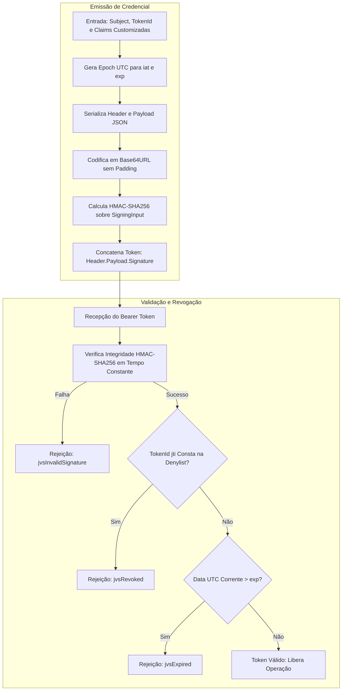

# MÓDULO 34: Validador e Emissor de Tokens JWT (TDlpJwtSecurityManager)

Em arquiteturas empresariais modernas desenvolvidas em Delphi 12 Athens+ (incluindo backends Horse, MARS-Curiosity, RAD Server e clientes ricos VCL/FMX), a circulação de credenciais puras de usuário em cada requisição é inadmissível. O uso de tokens **JWT (RFC 7519)** com criptografia simétrica HMAC-SHA256 permite validação descentralizada e alta vazão sem sobrecarregar bancos de dados relacionais com consultas de sessão repetitivas.

Neste módulo, implementamos o **`TDlpJwtSecurityManager`**, integrando os recursos de hash otimizados de `System.Hash` e codificação Base64URL em conformidade com as diretivas de segurança corporativa.

---

## 1. Fluxo Criptográfico de Emissão e Validação



---

## 2. Padrões de Segurança: Timing Attacks e Base64URL

A codificação de URL padrão RFC 7519 difere do Base64 comum por substituir `+` por `-`, `/` por `_` e omitir o preenchimento com `=`, evitando que os tokens quebrem cabeçalhos HTTP `Authorization: Bearer <token>`:

```pascal
function TDlpJwtSecurityManager.Base64UrlEncode(const InputBytes: TBytes): string;
begin
  Result := TNetEncoding.Base64URL.EncodeBytesToString(InputBytes);
  Result := StringReplace(Result, #13, '', [rfReplaceAll]);
  Result := StringReplace(Result, #10, '', [rfReplaceAll]);
  Result := StringReplace(Result, '=', '', [rfReplaceAll]);
end;
```

A validação de assinatura adota obrigatoriamente rotina em tempo constante para eliminar riscos de vazamento de chave por análise de latência.

---

## 3. Código-Fonte e Registro na Paleta

O código completo está disponível em [`DlpJwtSecurityManager.pas`](file:///d:/Projetos%20AntiGravity/Livros%20componentes/Livro2_Delphi_VCL_FMX/code/units/DlpJwtSecurityManager.pas).

O componente é registrado na paleta `'Delphi Engenharia Avancada'`, permitindo fácil acoplamento a módulos de autenticação e comunicação HTTP.
