# MÓDULO 35: Cofre Seguro de Credenciais e Segredos (TDlpCryptoVaultStorage)

A segurança em camadas (*Defense in Depth*) prescreve que dados altamente sensíveis não devem residir desprotegidos em nenhum ponto do ciclo de vida da aplicação. Ferramentas forenses e malwares especializados (como *Process Dumper* e *Mimikatz*) realizam varreduras na memória do processo buscando padrões de tokens OAuth, chaves de API e strings de conexão de bancos de dados como Oracle, PostgreSQL e SQL Server.

Neste módulo, implementamos o **`TDlpCryptoVaultStorage`** para Delphi 12 Athens+, garantindo que segredos empresariais permaneçam cifrados mesmo durante sua residência na memória RAM e sejam eliminados deterministicamente após o uso.

---

## 1. Topologia de Proteção em Memória

```mermaid
graph TD
    subgraph Inicialização Dinâmica
        A[Injeção de Entropia: PID + TickCount + Hora + Rand] --> B[Geração de FMasterRuntimeKey via THashSHA2]
    end

    subgraph Operação StoreSecret
        C[Entrada: Chave e Segredo] --> D[Converte em TBytes]
        D --> E[Gera Byte Salt Exclusivo]
        E --> F[Transformação XOR com Chave Mestre e Salt]
        F --> G[Armazena em TDlpVaultEntry]
        G --> H[SecureClearBuffer: Sobrescreve TBytes com Zeros]
    end

    subgraph Operação RetrieveSecret
        I[Solicitação da Chave] --> J[Decifra em Buffer Efêmero]
        J --> K[Gera String de Retorno]
        K --> L[SecureClearBuffer: Limpeza Imediata do Buffer Efêmero]
    end
```



---

## 2. Destruição Determinística de Buffers (ZeroMemory)

Para prevenir que o compilador otimize ou descarte chamadas de limpeza consideradas "mortas" (*Dead Store Elimination*), o componente força a sobrescrita byte a byte:

```pascal
procedure TDlpCryptoVaultStorage.SecureClearBuffer(var Buffer; Size: Integer);
var
  P: PByte;
  i: Integer;
begin
  P := PByte(@Buffer);
  for i := 0 to Size - 1 do
    P[i] := 0;
end;
```

A persistência em arquivo (`SaveVaultToFile` e `LoadVaultFromFile`) utiliza derivação de chave simétrica com salting estendido, assegurando que o arquivo do cofre armazenado em disco seja indecifrável sem a senha mestra configurada pelo administrador do sistema.

---

## 3. Código-Fonte e Registro na Paleta

O código completo do componente está disponível em [`DlpCryptoVaultStorage.pas`](file:///d:/Projetos%20AntiGravity/Livros%20componentes/Livro2_Delphi_VCL_FMX/code/units/DlpCryptoVaultStorage.pas).

O componente é registrado na paleta `'Delphi Engenharia Avancada'`, permitindo fácil integração com formulários de login, data modules e microserviços de backend.
