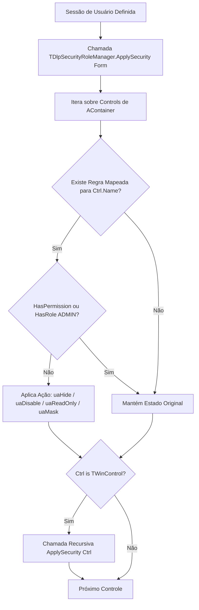

# MÓDULO 36: Motor de Permissões Baseadas em Papéis (TDlpSecurityRoleManager)

A segurança em nível de apresentação (*Presentation-Layer Security*) garante que interfaces com o usuário reflitam fielmente os privilégios concedidos pelo modelo de controle de acesso corporativo. Sem um gerenciador centralizado, sistemas corporativos no Delphi 12 Athens+ acabam repletos de código imperativo redundante nos formulários VCL, aumentando drasticamente o custo de manutenção e a probabilidade de falhas de segurança.

Neste módulo, implementamos o **`TDlpSecurityRoleManager`**, um componente VCL que adota o padrão declarativo de coleção de regras, inspeciona recursivamente a hierarquia de `TWinControl` e aplica restrições contextuais em tempo de execução.

---

## 1. Fluxo de Varredura e Hierarquia VCL



---

## 2. Flexibilidade e Design-Time Support

Ao implementar a coleção tipada `TDlpRolePermissionRules` herdada de `TCollection`, o componente permite que o arquiteto de software ou desenvolvedor configure todas as regras de permissão da tela visualmente através do editor de coleções da IDE do Delphi.

Em tempo de execução, a chamada única no evento `OnShow` do formulário ativa a proteção completa:

```pascal
procedure TfrmCadastroClientes.FormShow(Sender: TObject);
begin
  SecurityRoleManager.ApplySecurity(Self);
end;
```

---

## 3. Código-Fonte e Registro na Paleta

O código completo do componente está disponível em [`DlpSecurityRoleManager.pas`](file:///d:/Projetos%20AntiGravity/Livros%20componentes/Livro2_Delphi_VCL_FMX/code/units/DlpSecurityRoleManager.pas).

O componente é registrado na paleta `'Delphi Engenharia Avancada'`, pronto para distribuição e integração corporativa.
