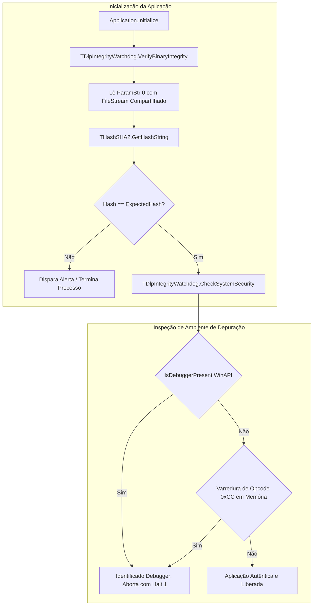

# MÓDULO 37: Auditor de Integridade de Executáveis (TDlpIntegrityWatchdog)

A segurança cibernética de aplicações comerciais e industriais compiladas no Delphi 12 Athens+ exige proteção ativa contra alterações não autorizadas no código de máquina. A modificação de binários (.exe / .dll) em clientes finais para contornar licenciamento, alterar rotinas fiscais ou extrair segredos industriais é uma ameaça tangível.

Neste módulo, implementamos o **`TDlpIntegrityWatchdog`**, integrando cálculo de integridade SHA-256 do arquivo executável (`System.Hash.THashSHA2`), interrogação direta à API do Windows (`IsDebuggerPresent`) e análise de prólogo de memória contra *hooks* maliciosos.

---

## 1. Fluxo de Inspeção em Camadas



---

## 2. Aborto Seguro e Confiabilidade

Quando uma violação de integridade é confirmada, o componente não deve exibir mensagens de depuração detalhadas que ajudem o invasor. Ele dispara o evento `OnTamperDetected` para telemetria remota e encerra imediatamente a execução através do procedimento nativo `Halt(1)`:

```pascal
procedure TDlpIntegrityWatchdog.TriggerViolation(AType: TDlpTamperType; const ADesc: string);
var
  ShouldAbort: Boolean;
begin
  ShouldAbort := FTerminateOnViolation;
  if Assigned(FOnTamperDetected) then
    FOnTamperDetected(Self, AType, ADesc, ShouldAbort);
  if ShouldAbort then
    Halt(1);
end;
```

---

## 3. Código-Fonte e Registro na Paleta

O código integral encontra-se em [`DlpIntegrityWatchdog.pas`](file:///d:/Projetos%20AntiGravity/Livros%20componentes/Livro2_Delphi_VCL_FMX/code/units/DlpIntegrityWatchdog.pas).

O componente é registrado na paleta `'Delphi Engenharia Avancada'`, fornecendo uma linha de defesa essencial para softwares comerciais.
