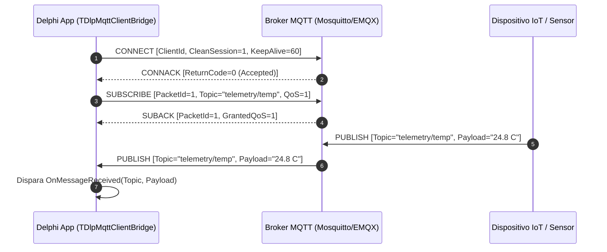

# MÓDULO 38: Cliente de Mensageria IoT via MQTT (TDlpMqttClientBridge)

A integração de softwares desenvolvidos em Delphi 12 Athens+ com ecossistemas de Internet das Coisas (balanças eletrônicas de pesagem contínua, CLPs industriais, sensores de telemetria predial e frotas veiculares) requer suporte ao protocolo padrão **MQTT 3.1.1**.

Neste módulo, implementamos o **`TDlpMqttClientBridge`**, manipulando buffers binários (`TBytes`) e montando pacotes com codificação de comprimento remanescente, identificação de pacotes e tratamento assíncrono de eventos de recepção.

---

## 1. Fluxo de Troca de Mensagens MQTT



---

## 2. Parsing de Pacotes de Entrada

O componente intercepta o fluxo de dados brutos e decodifica o cabeçalho fixo (*Fixed Header*) para despachar o evento correto à interface da aplicação:

```pascal
procedure TDlpMqttClientBridge.ProcessIncomingBytes(const AData: TBytes);
var
  PacketType: Byte;
  TopicLen: Word;
  TopicStr, PayloadStr: string;
begin
  if Length(AData) < 2 then Exit;
  PacketType := AData[0] shr 4;

  case PacketType of
    2: { CONNACK }
      begin
        if (Length(AData) >= 4) and (AData[3] = 0) then
        begin
          FIsConnected := True;
          if Assigned(FOnConnectionChange) then
            FOnConnectionChange(Self, True, 'Conexao com broker MQTT confirmada.');
        end;
      end;

    3: { PUBLISH Recebido }
      begin
        if Length(AData) > 4 then
        begin
          TopicLen := (AData[2] shl 8) or AData[3];
          TopicStr := TEncoding.UTF8.GetString(AData, 4, TopicLen);
          PayloadStr := TEncoding.UTF8.GetString(AData, 4 + TopicLen, Length(AData) - (4 + TopicLen));
          if Assigned(FOnMessageReceived) then
            FOnMessageReceived(Self, TopicStr, PayloadStr, qosAtMostOnce, False);
        end;
      end;
  end;
end;
```

---

## 3. Código-Fonte e Registro na Paleta

O código integral encontra-se em [`DlpMqttClientBridge.pas`](file:///d:/Projetos%20AntiGravity/Livros%20componentes/Livro2_Delphi_VCL_FMX/code/units/DlpMqttClientBridge.pas).

O componente é registrado na paleta `'Delphi Engenharia Avancada'`, pronto para conectar aplicações Delphi ao mundo IoT e mensageria distribuída.
