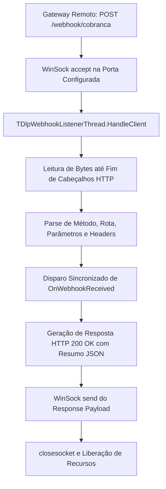

# MÓDULO 39: Servidor de Webhooks Embutido (TDlpEmbeddedWebhookServer)

A modernização de aplicações ERP e PDV no Delphi 12 Athens+ passa pela capacidade de receber notificações ativas da nuvem sem a necessidade de manter laços repetitivos de consulta (*Polling* de banco ou requisições HTTP contínuas). A recepção direta de Webhooks de provedores de pagamento (Stripe, Mercado Pago, Asaas) acelera a confirmação de faturamento e reduz drasticamente o tráfego de rede.

Neste módulo, implementamos o **`TDlpEmbeddedWebhookServer`**, construindo um microservidor HTTP baseado na API de Sockets nativa do Windows (`Winapi.WinSock2`), garantindo velocidade de resposta na ordem de microssegundos e consumo mínimo de memória.

---

## 1. Topologia de Conexão e Ciclo de Vida HTTP



---

## 2. Extração de Assinaturas e Proteção Anti-Spoofing

A segurança de webhooks exige que o servidor receptor valide a assinatura criptográfica contida nos cabeçalhos (como `X-Signature` ou `X-Hub-Signature-256`) comparando com o token secreto configurado em `SecretToken`.

A estrutura `TDlpWebhookRequest` isola o método HTTP, rota, cabeçalhos de assinatura e corpo bruto da mensagem:

```pascal
TDlpWebhookRequest = record
  Method: string;
  Path: string;
  QueryString: string;
  ContentType: string;
  Signature: string;
  RawBody: string;
  ClientIP: string;
end;
```

---

## 3. Código-Fonte e Registro na Paleta

O código integral encontra-se em [`DlpEmbeddedWebhookServer.pas`](file:///d:/Projetos%20AntiGravity/Livros%20componentes/Livro2_Delphi_VCL_FMX/code/units/DlpEmbeddedWebhookServer.pas).

O componente é registrado na paleta `'Delphi Engenharia Avancada'`, operando perfeitamente em aplicações Desktop VCL, FMX e em Daemons/Windows Services.
