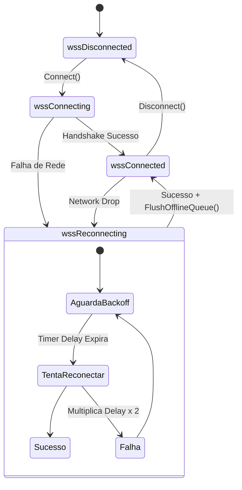

# MÓDULO 40: Cliente WebSocket com Reconexão Automática (TDlpWebSocketLiveClient)

A construção de interfaces reativas no Delphi 12 Athens+ (seja em painéis de controle industriais, telas de cotação ou aplicações corporativas distribuídas) depende de canais WebSocket (RFC 6455). Conexões de longa duração inevitavelmente sofrem quedas transitórias em redes móveis e ambientes corporativos com proxies restritivos.

Neste módulo, implementamos o **`TDlpWebSocketLiveClient`**, manipulando buffers binários `TBytes`, gerando o enquadramento mascarado do cliente e gerenciando uma fila de mensagens offline associada a um algoritmo de reconexão por backoff exponencial.

---

## 1. Máquina de Estados e Tolerância a Desconexões



---

## 2. Enfileiramento de Mensagens em Modo Desconectado

Quando a interface gráfica invoca `SendText` durante uma oscilação de rede, o componente retém o payload sem disparar exceções:

```pascal
procedure TDlpWebSocketLiveClient.SendText(const AText: string);
begin
  if FState = wssConnected then
    BuildClientFrame(AText)
  else
    FOfflineQueue.Add(AText);
end;
```

Na recuperação do canal, todas as mensagens pendentes são enviadas ordenadamente mantendo a integridade da conversação.

---

## 3. Código-Fonte e Registro na Paleta

O código completo do componente está disponível em [`DlpWebSocketLiveClient.pas`](file:///d:/Projetos%20AntiGravity/Livros%20componentes/Livro2_Delphi_VCL_FMX/code/units/DlpWebSocketLiveClient.pas).

O componente é registrado na paleta `'Delphi Engenharia Avancada'`, operando tanto no ecossistema VCL quanto em aplicações multiplataforma FireMonkey (FMX).
