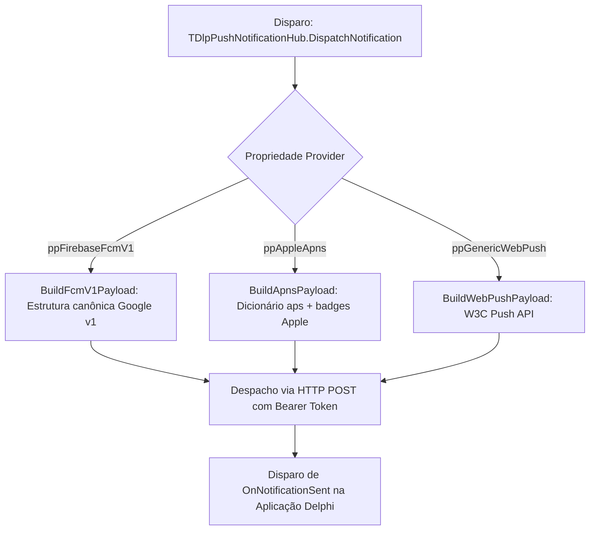

# MÓDULO 41: Hub de Notificações Push Desktop/Mobile (TDlpPushNotificationHub)

Em ecossistemas comerciais baseados em Delphi 12 Athens+ onde clientes utilizam tanto aplicações desktop VCL no escritório quanto aplicativos móveis FireMonkey (FMX) no Android ou iOS, a centralização do envio de mensagens push em um componente desacoplado acelera a implementação de fluxos de autorização em dois fatores (2FA), alertas de estoque baixo e chamadas operacionais urgentes.

Neste módulo, implementamos o **`TDlpPushNotificationHub`**, gerando payloads JSON canônicos e configurando prioridades de entrega para FCM v1, APNs e WebPush.

---

## 1. Arquitetura Multicanal do Hub



---

## 2. Tipagem Estruturada e Métodos Construtores

Em vez de concatenar strings JSON manuais propensas a falhas de pontuação e aspas, o desenvolvedor utiliza o método de fábrica `CreateMessage`:

```pascal
var
  Msg: TDlpPushMessage;
begin
  Msg := PushHub.CreateMessage(
    'eX8jF...token_do_aparelho',
    'Pedido Aprovado!',
    'O faturamento do pedido #1893 foi concluído com sucesso.'
  );
  Msg.Priority := ppHigh;
  Msg.Badge := 1;
  PushHub.DispatchNotification(Msg);
end;
```

---

## 3. Código-Fonte e Registro na Paleta

O código completo está disponível em [`DlpPushNotificationHub.pas`](file:///d:/Projetos%20AntiGravity/Livros%20componentes/Livro2_Delphi_VCL_FMX/code/units/DlpPushNotificationHub.pas).

O componente é registrado na paleta `'Delphi Engenharia Avancada'`, pronto para integração em soluções corporativas modernas.
