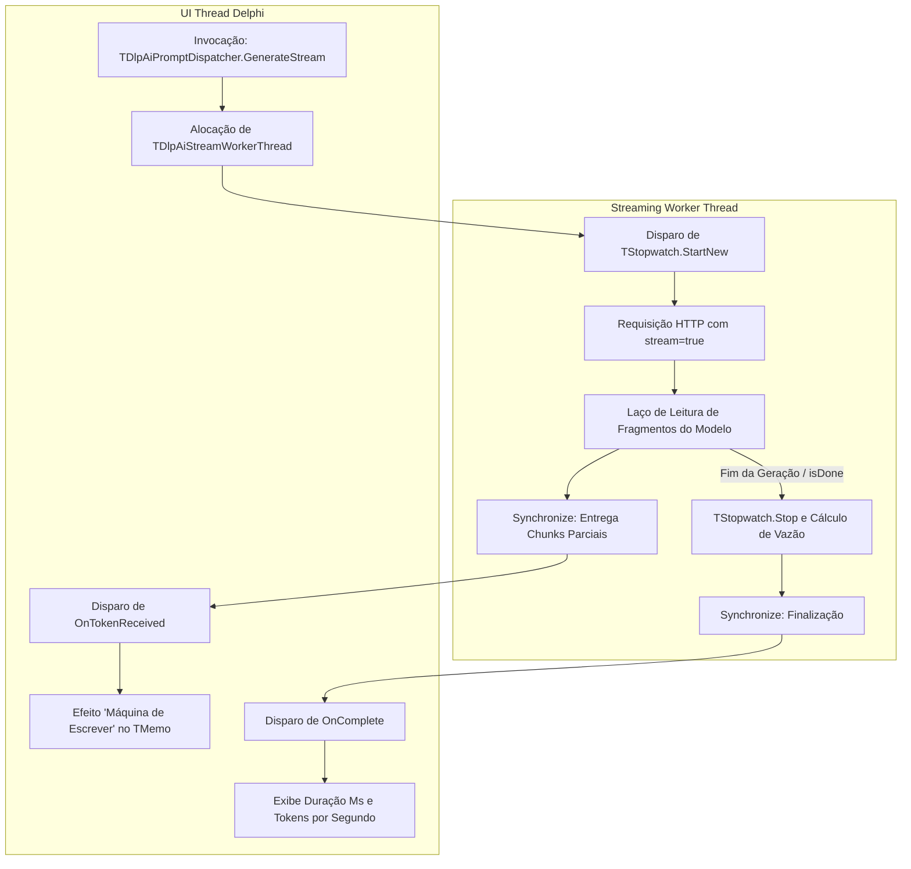

# MÓDULO 42: Dispatcher de Prompts para LLMs Locais (TDlpAiPromptDispatcher)

A demanda por inteligência artificial em sistemas comerciais construídos em Delphi 12 Athens+ exige soluções seguras contra vazamento de segredos industriais e custos imprevistos de APIs em nuvem. A execução de servidores de inferência locais como Ollama, LM Studio e vLLM em estações com placas de vídeo dedicadas ou servidores locais corporativos permite integrar assistentes de IA de forma soberana e privada.

Neste módulo, implementamos o **`TDlpAiPromptDispatcher`**, capaz de despachar requisições para LLMs locais, gerenciar streaming de tokens em tempo real através de `TThread` isolada e mensurar latência via `System.Diagnostics.TStopwatch`.

---

## 1. Topologia de Concorrência e Métricas



---

## 2. Padrão de Integração e Cancelamento

A arquitetura orientada a eventos permite que a interface visual permaneça fluida e reativa durante todo o processo de inferência:

```pascal
procedure TfrmAtendimento.btnGerarRespostaClick(Sender: TObject);
begin
  MemoResposta.Lines.Clear;
  AiDispatcher.GenerateStream(MemoPergunta.Text);
end;

procedure TfrmAtendimento.AiDispatcherTokenReceived(Sender: TObject;
  const ATokenChunk, ACumulativeText: string);
begin
  MemoResposta.Lines.Text := ACumulativeText;
  MemoResposta.SelStart := Length(MemoResposta.Lines.Text);
end;
```

---

## 3. Código-Fonte e Registro na Paleta

O código completo do componente está disponível em [`DlpAiPromptDispatcher.pas`](file:///d:/Projetos%20AntiGravity/Livros%20componentes/Livro2_Delphi_VCL_FMX/code/units/DlpAiPromptDispatcher.pas).

O componente é registrado na paleta `'Delphi Engenharia Avancada'`, pronto para enriquecer sistemas ERP com processamento de linguagem natural.
