# MÓDULO 44: Motor de Busca Vetorial e Embeddings (TDlpVectorEmbeddingStore)

A implementação de mecanismos de busca semântica em catálogos com centenas de milhares de produtos, manuais técnicos e bases de clientes em Delphi 12 Athens+ capacita sistemas comerciais a responder perguntas conceituais de clientes sem necessitar de bancos vetoriais em nuvem (como Pinecone, Weaviate ou Milvus), eliminando custos recorrentes em moeda estrangeira e latência de rede.

Neste módulo, implementamos o **`TDlpVectorEmbeddingStore`**, um banco de dados vetorial nativo em memória construído com `TArray<Single>`, provendo indexação vetorial, cálculo de similaridade por cosseno e persistência binária otimizada.

---

## 1. Arquitetura de Busca Semântica e RAG

```mermaid
graph TD
    subgraph Fase 1: Ingestão de Conhecimento
        A[Catálogo de Produtos / FAQ Corporativo] --> B[Gera Embeddings 384d / 768d]
        B --> C[TDlpVectorEmbeddingStore.AddDocument]
        C --> D[Persistência em Arquivo Binário VECSTORE]
    end

    subgraph Fase 2: Consulta e Ranking
        E[Busca do Usuário: 'furadeira de impacto sem fio'] --> F[Gera Query Embedding]
        F --> G[TDlpVectorEmbeddingStore.SearchTopK QueryVector, 5]
        G --> H[Cálculo Paralelizável de Cosine Similarity]
        H --> I[Ranking Parcial Top-K Ordenado por Score]
        I --> J[Exibição na Interface VCL/FMX]
    end
```



---

## 2. Álgebra Linear e Normalização de Módulo

A similaridade por cosseno quantifica a coincidência de direção entre os dois vetores multidimensionais, variando no intervalo $[-1.0, +1.0]$, onde valores próximos a $+1.0$ atestam afinidade semântica máxima:

```pascal
function TDlpVectorEmbeddingStore.ComputeCosineSimilarity(const V1, V2: TDlpEmbeddingVector;
  Mag1, Mag2: Single): Single;
var
  Dot, Denominator: Single;
  i, Len: Integer;
begin
  Len := Length(V1);
  if (Len <> Length(V2)) or (Len = 0) then Exit(0.0);

  Dot := 0.0;
  for i := 0 to Len - 1 do
    Dot := Dot + (V1[i] * V2[i]);

  Denominator := Mag1 * Mag2;
  if Denominator > 0.000001 then
    Result := Dot / Denominator
  else
    Result := 0.0;
end;
```

---

## 3. Código-Fonte e Registro na Paleta

O código completo do componente está disponível em [`DlpVectorEmbeddingStore.pas`](file:///d:/Projetos%20AntiGravity/Livros%20componentes/Livro2_Delphi_VCL_FMX/code/units/DlpVectorEmbeddingStore.pas).

O componente é registrado na paleta `'Delphi Engenharia Avancada'`, permitindo criação imediata de motores de recomendação e RAG em Delphi.
