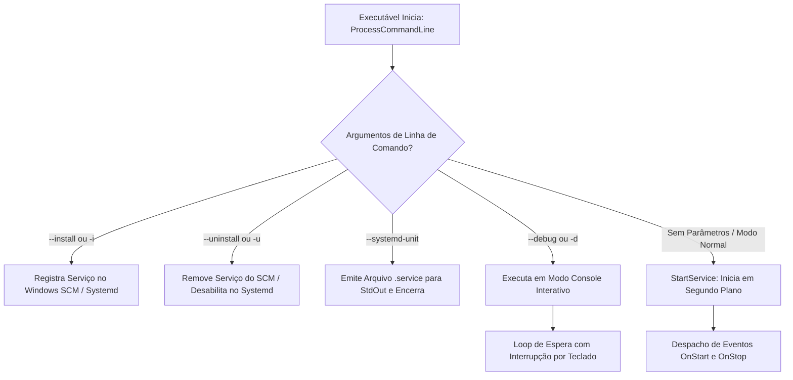

# MÓDULO 45: Construtor Universal de Daemons e Serviços (TDlpSystemDaemonController)

A consolidação de arquiteturas de backend corporativas no Delphi 12 Athens+ exige que o mesmo binário ou projeto possa ser implantado como um Serviço do Windows gerenciado pelo Service Control Manager (SCM) e como um Daemon Linux supervisionado pelo Systemd, além de permitir testes rápidos no terminal local sem a burocracia de registrar o serviço no sistema operacional durante a fase de desenvolvimento.

Neste módulo, implementamos o **`TDlpSystemDaemonController`**, provendo despacho unificado de eventos de ciclo de vida (`OnStart`, `OnStop`, `OnPause`, `OnContinue`), controle de parâmetros de inicialização e suporte a logs estruturados.

---

## 1. Topologia de Instalação e Execução



---

## 2. Padrão de Integração em Projetos de Console / Service

No arquivo principal do projeto (.dpr), o controle de execução é simplificado para uma chamada declarativa:

```pascal
program BackendDaemon;

{$APPTYPE CONSOLE}

uses
  System.SysUtils,
  DlpSystemDaemonController in 'units\DlpSystemDaemonController.pas';

var
  Daemon: TDlpSystemDaemonController;
begin
  Daemon := TDlpSystemDaemonController.Create(nil);
  try
    Daemon.ServiceName := 'DelphiEnterpriseService';
    Daemon.OnStart := procedure(Sender: TObject; var Handled: Boolean)
    begin
      Writeln('Serviço iniciado com sucesso.');
    end;
    Daemon.ProcessCommandLine;
  finally
    Daemon.Free;
  end;
end.
```

---

## 3. Código-Fonte e Registro na Paleta

O código completo do componente está disponível em [`DlpSystemDaemonController.pas`](file:///d:/Projetos%20AntiGravity/Livros%20componentes/Livro2_Delphi_VCL_FMX/code/units/DlpSystemDaemonController.pas).

O componente é registrado na paleta `'Delphi Engenharia Avancada'`, pronto para a construção de daemons de missão crítica.
