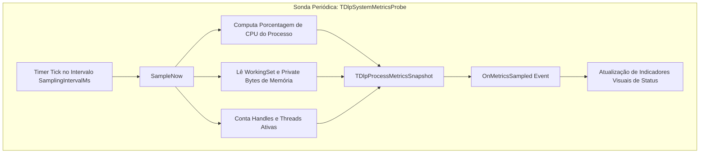

# MÓDULO 46: Sonda de Monitoramento de Sistema (TDlpSystemMetricsProbe)

O diagnóstico proativo de desempenho em sistemas corporativos desenvolvidos em Delphi 12 Athens+ previne degradações de velocidade decorrentes de fragmentação de memória ou concorrência excessiva de threads de background.

Neste módulo, implementamos o **`TDlpSystemMetricsProbe`**, gerando instantâneos periódicos com consumo de CPU, tamanho do conjunto de trabalho de memória (*Working Set*) e contagem de handles abertos, alimentando dashboards de saúde da aplicação.

---

## 1. Métricas Essenciais de Telemetria



---

## 2. Padrão de Integração em Dashboards de Monitoramento

O evento `OnMetricsSampled` entrega os valores já consolidados para consumo direto em componentes visuais (como os criados na Parte VIII):

```pascal
procedure TfrmPrincipal.SystemMetricsProbeSampled(Sender: TObject;
  const ASnapshot: TDlpProcessMetricsSnapshot);
begin
  GaugeCpu.Value := ASnapshot.CpuUsagePercent;
  lblMemoria.Caption := Format('RAM: %.1f MB', [ASnapshot.WorkingSetBytes / (1024 * 1024)]);
  lblHandles.Caption := Format('Handles: %d', [ASnapshot.OsHandlesCount]);
end;
```

---

## 3. Código-Fonte e Registro na Paleta

O código completo do componente está disponível em [`DlpSystemMetricsProbe.pas`](file:///d:/Projetos%20AntiGravity/Livros%20componentes/Livro2_Delphi_VCL_FMX/code/units/DlpSystemMetricsProbe.pas).

O componente é registrado na paleta `'Delphi Engenharia Avancada'`, permitindo fácil adição de telemetria a qualquer projeto Delphi.
