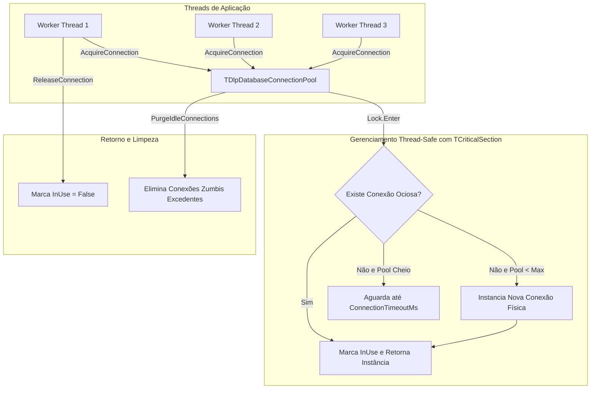

# MÓDULO 47: Gerenciador de Pool de Conexões SQL (TDlpDatabaseConnectionPool)

O gerenciamento eficiente de conexões com bancos de dados relacionais em aplicações servidoras de alta demanda (como APIs Horse/DataSnap ou backends corporativos no Delphi 12 Athens+) exige uma camada de pooling dedicada para evitar a sobrecarga de conexões concorrentes físicas no FireDAC.

Neste módulo, implementamos o **`TDlpDatabaseConnectionPool`**, orquestrando instâncias de conexões protegidas por `System.SyncObjs.TCriticalSection`, garantindo limites mínimos e máximos configuráveis, tolerância a timeout de aquisição e expurgo preventivo de conexões inativas.

---

## 1. Topologia de Concorrência e Métricas do Pool



---

## 2. Padrão de Uso em Worker Threads

O padrão clássico `try ... finally` assegura que a conexão alugada retorne ao pool mesmo se ocorrerem exceções de banco de dados:

```pascal
var
  ConnObj: TObject;
  Conn: TFDConnection;
begin
  if Pool.AcquireConnection(ConnObj, 3000) then
  begin
    Conn := TFDConnection(ConnObj);
    try
      // Executa consultas e atualizações SQL com segurança
      Conn.ExecSQL('UPDATE Parametros SET UltimoAcesso = NOW()');
    finally
      Pool.ReleaseConnection(ConnObj);
    end;
  end
  else
    raise Exception.Create('Pool de banco de dados esgotado. Tente novamente.');
end;
```

---

## 3. Código-Fonte e Registro na Paleta

O código integral encontra-se em [`DlpDatabaseConnectionPool.pas`](file:///d:/Projetos%20AntiGravity/Livros%20componentes/Livro2_Delphi_VCL_FMX/code/units/DlpDatabaseConnectionPool.pas).

O componente é registrado na paleta `'Delphi Engenharia Avancada'`, oferecendo uma infraestrutura essencial para aplicações de backend e clientes pesados.
