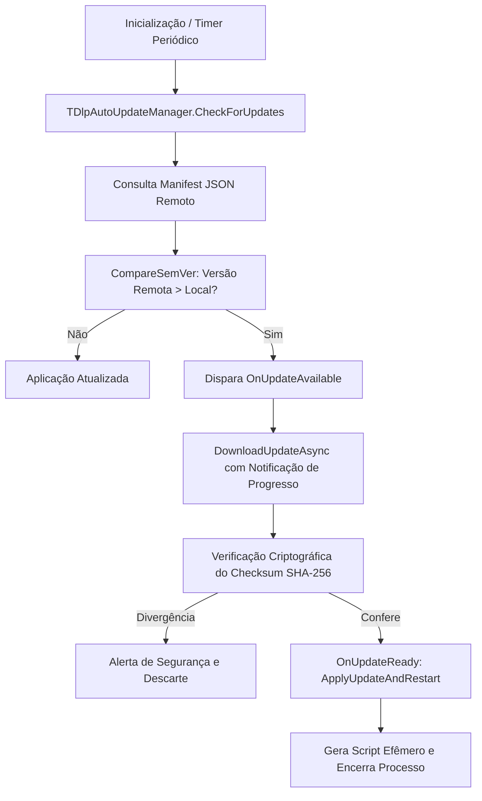

# MÓDULO 48: Motor de Atualização Automática (TDlpAutoUpdateManager)

A manutenção contínua de ecossistemas corporativos no Delphi 12 Athens+ requer esteiras de distribuição que mantenham as frotas de estações de trabalho sempre alinhadas com as últimas alterações da legislação tributária e melhorias de software sem gerar chamados recorrentes para o Help Desk.

Neste módulo, implementamos o **`TDlpAutoUpdateManager`**, organizando o ciclo completo de verificação semântica de versão, download desacoplado, verificação de hash SHA-256 e substituição atômica com reinicialização transparente.

---

## 1. Topologia de Entrega de Patches



---

## 2. Comparação de Versões SemVer (Semantic Versioning)

A precedência de versões segue o padrão `MAJOR.MINOR.PATCH`:

```pascal
function TDlpAutoUpdateManager.CompareSemVer(const V1, V2: string): Integer;
var
  P1, P2: TArray<string>;
  Maj1, Min1, Patch1, Maj2, Min2, Patch2: Integer;
begin
  P1 := V1.Split(['.']);
  P2 := V2.Split(['.']);
  // ... Parsing de inteiros e comparação hierárquica ...
end;
```

---

## 3. Código-Fonte e Registro na Paleta

O código completo do componente está disponível em [`DlpAutoUpdateManager.pas`](file:///d:/Projetos%20AntiGravity/Livros%20componentes/Livro2_Delphi_VCL_FMX/code/units/DlpAutoUpdateManager.pas).

O componente é registrado na paleta `'Delphi Engenharia Avancada'`, pronto para modernizar os processos de entrega contínua em Delphi.
