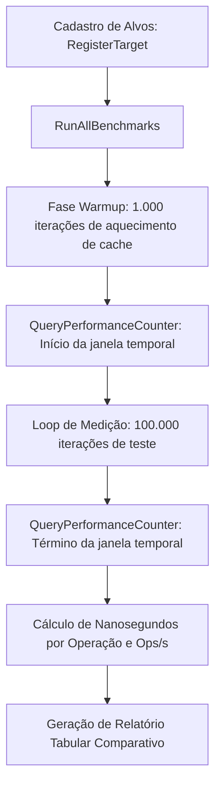

# MÓDULO 49: Harness de Micro-Benchmarks de Código (TDlpCodeBenchmarkHarness)

A garantia de alta vazão e eficiência algorítmica no Delphi 12 Athens+ exige instrumentos científicos de medição de tempo de execução. Ao comparar abordagens concorrentes (como concatenação de strings com operador `+` versus `TStringBuilder`, ou serialização manual de memória versus RTTI estendida), variações sutis na ordem de nanossegundos decidem a escalabilidade da solução.

Neste módulo, implementamos o **`TDlpCodeBenchmarkHarness`**, utilizando os temporizadores de hardware de alta resolução da API do Windows (`QueryPerformanceCounter` / `QueryPerformanceFrequency`) e amostragem estatística repetida com fase de aquecimento prévio de caches.

---

## 1. Topologia de Micro-Profiling de Código



---

## 2. Exemplo de Uso: Benchmark Comparativo

```pascal
var
  Harness: TDlpCodeBenchmarkHarness;
begin
  Harness := TDlpCodeBenchmarkHarness.Create(nil);
  try
    Harness.RegisterTarget('Concatenação com +', BenchmarkConcatSimples);
    Harness.RegisterTarget('TStringBuilder', BenchmarkStringBuilder);
    Harness.RegisterTarget('Buffer de Memória Direta', BenchmarkMemoryBuffer);
    
    Writeln(Harness.RunAllBenchmarks);
  finally
    Harness.Free;
  end;
end;
```

---

## 3. Código-Fonte e Registro na Paleta

O código completo do componente está disponível em [`DlpCodeBenchmarkHarness.pas`](file:///d:/Projetos%20AntiGravity/Livros%20componentes/Livro2_Delphi_VCL_FMX/code/units/DlpCodeBenchmarkHarness.pas).

O componente é registrado na paleta `'Delphi Engenharia Avancada'`, fornecendo uma suíte completa de micro-benchmarking para desenvolvedores exigentes.
