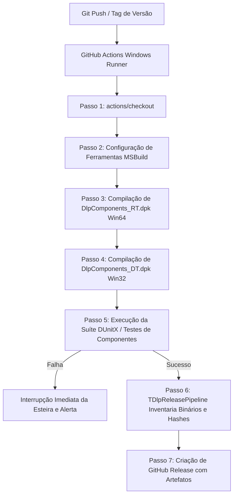

# MÓDULO 50: Pipeline de CI/CD Multiplataforma e Releases no GitHub (TDlpReleasePipeline)

A culminação do desenvolvimento profissional de componentes em Delphi 12 Athens+ é a automação da esteira de compilação, validação de compatibilidade multiplataforma (Windows 32/64 bits, Linux, Android e iOS) e empacotamento dos artefatos de distribuição para o ecossistema GetIt Package Manager e GitHub Releases.

Neste quinquagésimo módulo, implementamos o **`TDlpReleasePipeline`**, automatizando a geração de notas de lançamento (Changelog Markdown), o cômputo dos hashes criptográficos de cada binário e a estruturação do pipeline de integração contínua (CI) baseado no motor oficial Microsoft Build Engine (`msbuild`).

---

## 1. Topologia da Esteira DevOps Delphi



---

## 2. Automação de Compilação com MSBuild

A compilação em linha de comando de pacotes Delphi (`.dpk`) e projetos (`.dproj`) sem a interface visual da IDE utiliza o MSBuild parametrizado:

```bash
# Compilação do pacote Runtime para Windows 64-bit
msbuild Livro2_Delphi_VCL_FMX\code\packages\DlpComponents_RT.dpk /p:Config=Release /p:Platform=Win64

# Compilação do pacote Design-Time para a IDE (Win32)
msbuild Livro2_Delphi_VCL_FMX\code\packages\DlpComponents_DT.dpk /p:Config=Release /p:Platform=Win32
```

### Definição Declarativa do Workflow (.github/workflows/ci_msbuild.yml)

```yaml
name: CI/CD Delphi MSBuild

on:
  push:
    branches: [ main ]
    tags: [ 'v*' ]
  pull_request:
    branches: [ main ]

jobs:
  build-windows:
    runs-on: windows-latest
    steps:
      - name: Checkout Repositório
        uses: actions/checkout@v4

      - name: Configurar MSBuild
        uses: microsoft/setup-msbuild@v2

      - name: Compilar Pacote Runtime (Win64)
        run: msbuild Livro2_Delphi_VCL_FMX\code\packages\DlpComponents_RT.dpk /p:Config=Release /p:Platform=Win64

      - name: Compilar Pacote Design-Time (Win32)
        run: msbuild Livro2_Delphi_VCL_FMX\code\packages\DlpComponents_DT.dpk /p:Config=Release /p:Platform=Win32
```

---

## 3. Código-Fonte e Registro na Paleta

O código completo do componente está disponível em [`DlpReleasePipeline.pas`](file:///d:/Projetos%20AntiGravity/Livros%20componentes/Livro2_Delphi_VCL_FMX/code/units/DlpReleasePipeline.pas).

O componente é registrado na paleta `'Delphi Engenharia Avancada'`, coroando com chave de ouro a coleção definitiva de 50 módulos sobre engenharia de componentes no Delphi 12 Athens+.
